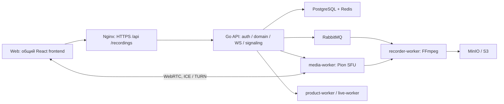
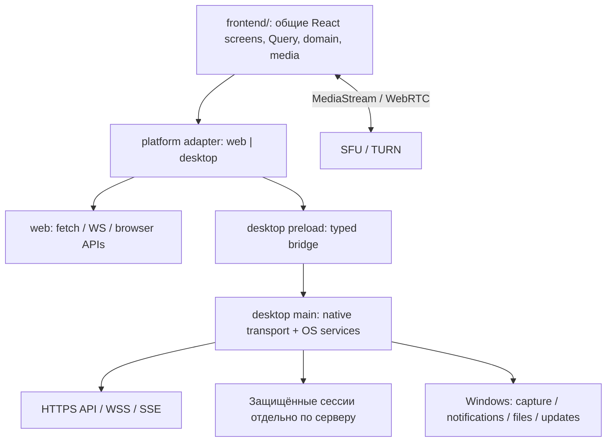

# MeetSpace для Windows — этап 01: аудит и архитектура

Дата: **13 октября 2026**, часовой пояс Europe/Moscow. Статус: **аудит завершён; реализация desktop не начата**.

## 1. Решение и границы результата

Рекомендуется **Electron + существующий React/TypeScript/Vite frontend**, с `desktop/` для main/preload/упаковки и общей кодовой базой `frontend/` для web и desktop. Архив Windows используется как визуальный и UX-референс. Его JavaScript, демонстрационные данные и `localStorage`-модель не становятся вторым production-интерфейсом.

Главный интеграционный риск: текущий клиент и backend опираются на **same-origin**. Упакованный renderer нельзя подключить к серверу простым изменением базового URL: затронуты cookies, CSRF, REST, оба WebSocket, SSE, загрузка файлов, приглашения и OAuth callback. Рекомендован локальный renderer с узким типизированным транспортом через main; его совместимость должна быть доказана отдельным следующим этапом.

Код уже содержит встречи, SFU/WebRTC, запись, личные и групповые чаты, папки, поиск по сообщениям и управление аккаунтами. Наличие кода не подтверждает работу каждого сценария на опубликованном сервере или Windows. Готового Electron/Tauri shell, Windows installer, update feed и Windows CI в HEAD нет.

В этом этапе добавлен только этот отчёт. Продуктовые исходники, backend, lockfile и deployment не изменялись. Сервер проверялся только публичными GET-запросами; аккаунты, встречи и записи не создавались. Следующие этапы автоматически не запускались.

## 2. Зафиксированные исходные материалы

| Материал | Фактическое состояние |
| --- | --- |
| Репозиторий | `https://github.com/janickiy/meet-space`, свежий clone ветки `main` |
| Проверенный HEAD | `66e482c9701b6c13f58bc93aee8d9f5cf932dd34`, 2026-10-13 20:07:43 +03:00; «Добавлена возможность добавления нового аккаунта и переключения между аккаунтами» |
| Начальное рабочее дерево | Чистое, 884 tracked-файла; `AGENTS.md` в checkout не найден |
| Локальный checkout | `/Users/aleksandranickij/htdocs/лого/meet-space` |
| Постановка этапа | `/Users/aleksandranickij/Downloads/MEETSPACE_WINDOWS_DESKTOP_7_STAGES/CODEX_DESKTOP_01_01_AUDIT_ARCHITECTURE.md` |
| Дизайн | `/Users/aleksandranickij/Downloads/MeetSpace-Windows 4.zip` |
| SHA-256 архива | `f700810365f502befb814c75a3d7466f197276dec3015e1a2a03558630b26fe2` |
| Распакованный референс | `/Users/aleksandranickij/htdocs/лого/.work/desktop-audit-design/MeetSpace-Windows 4` |
| Среда аудита | macOS 27.0.1, Darwin ARM64; Go 1.26.9; поддерживаемый Node 24.19.0 для frontend |

Фактический код и manifest имеют приоритет над историческими отчётами. Вложенный промпт принят как спецификация **этапа 01**, а README/verification.json дизайна — как описание референса и прежних проверок, не как новые результаты этого аудита.

### Публичный сервер: наблюдения отдельно от checkout

Проверки выполнены 13 октября 2026, примерно в 21:49–22:00 MSK. Использована обычная проверка TLS, без `-k`, отключения сертификатов или входа под пользователем.

| Запрос | Наблюдение | Что подтверждает |
| --- | --- | --- |
| `GET https://meeting.janickiy.com/` | 200 HTML, `ssl_verify_result=0` | Доступность web entrypoint и доверенный TLS в среде аудита |
| `/version.json`, `/version` | 200 JSON: `v1.0.0-meeting.20261013-accounts.4`; commit `a659c5c117bbf47367a8def63c13b43715bbc8ff`; buildTime `2026-10-13T16:27:13Z` | Публичные метаданные deployment |
| `/api/v1/auth/me`, `/api/v1/capabilities` | 401 JSON без авторизации | Приватные API требуют авторизацию; enabled capabilities не определены |
| `/health`, `/health/ready` | 404 HTML на публичном origin | Внешний proxy не предоставляет эти health endpoints |
| `/ready`, `/readyz` | 200 **HTML SPA**, не JSON readiness | Такой HTTP 200 нельзя считать готовностью backend |
| `/api/v1/health` | 404 | Не является контрактом health API |

Deployment commit **не совпадает с HEAD** и отсутствует как Git-объект в полученном clone. Причина не установлена: это может быть другая история/сборка либо метаданные. Нельзя объявлять production идентичным проверенному checkout. Перед интеграционными испытаниями нужно связать серверный release manifest с фактическими исходниками.

Публичный HTML получил CSP с `script-src 'self'`, `style-src 'self'`, `connect-src 'self' wss://meeting.janickiy.com`, `object-src 'none'`, `frame-ancestors 'none'`, а также HSTS `max-age=31536000`, `nosniff`, `Referrer-Policy: no-referrer`. Это положительное наблюдение web deployment; локальная сборка Electron эти HTTP-заголовки автоматически не наследует.

## 3. Что изменилось относительно README и прежних документов

Последнее изменение корневого README: `e1031291de60597d22ca2cbeb3ba54846ad0d9c5`, 12 октября 2026 22:34:45 +03:00. После него в HEAD есть, в частности:

- `1d627dd`: поиск по сообщениям личных/групповых чатов, контекст найденного сообщения, repository/usecase и соответствующие API/UI.
- `66e482c`: список, добавление, переключение и удаление аккаунтов; изменения auth/session lifecycle и проверок доступа к данным удалённых пользователей.
- Изменения личных звонков и связанных компонентов также входят в diff после README; старые screenshots и отчёты не заменяют просмотр текущих компонентов.

README всё ещё содержит примеры `POST /api/v1/records/start` и `/records/end`, хотя там же описан их вывод из эксплуатации. В HEAD `internal/transport/http/retired_recording_routes.go` закрывает старые routes; desktop должен использовать конференционные recording endpoints. Ранние документы `realtime.md` и `media-sfu.md` описывают промежуточные этапы, включая уже снятые ограничения. Объяснение историчности есть в `docs/API.md:3–7`.

`docs/RELEASE_PROCESS.md:29–32` сообщает об удалении автоматизированных наборов по решению владельца. В текущем `.gitlab-ci.yml` нет запуска Go unit/race, browser, a11y или load tests. В более старых frontend/audit документах такие команды и PASS остаются. В HEAD заново присутствуют три Go test-файла, но frontend test scripts и тестовая инфраструктура отсутствуют. Исторические PASS не перенесены в таблицу результатов ниже; восстановление полного набора тестов не выполнялось.

`docs/recorder-worker-scheme.pdf` — шестистраничная схема прежнего browser→recorder ingest с `/api/records/*`; она не описывает актуальный conference SFU flow. Старый npm inventory также не равен текущему lockfile: в CSV 162 строки пакетов, из которых 84 пути отсутствуют в нынешнем lock. Для desktop SBOM/licensing следует заново собирать inventory из реально упакованных зависимостей; старый CSV не является release evidence.

## 4. Фактическая архитектура и стек

Это схема границ, не обещание высокой доступности: текущая deployment-модель — один Compose host. Управляющий API и медиа разделены. Клиент не должен обращаться к внутренним портам SFU, recorder, PostgreSQL, Redis, MinIO admin или RabbitMQ. Go/FFmpeg/Docker не требуется устанавливать на Windows-клиент.

| Область | Код / состояние HEAD | Решение для desktop |
| --- | --- | --- |
| UI | React/React DOM 19.3.0; React Router 8.4.0; TanStack Query 5.104.0; Lucide 1.49.0; Inter 5.3.0 | Переиспользовать компоненты, модели и styles |
| Build | Vite 8.3.1, TypeScript 7.0.2, Prettier 3.9.9; `frontend/package-lock.json` v3, 79 entries включая root | Сохранить текущий web build; отдельный mode/output для desktop |
| Node engines | `^22.22.2 || ^24.15.0 || >=26.0.0` | Системный Node 23.1.0 не подходит; проверки выполнены Node 24.19.0 |
| Vite | `frontend/vite.config.ts`: `/api` proxy → `API_PROXY_TARGET` либо `http://127.0.0.1:8085`; WS enabled; `changeOrigin:false`; targets Chrome120/Firefox120/Safari17 | Proxy — dev-only; desktop runtime transport проектируется отдельно |
| Routes | `frontend/src/App.tsx:202+`, BrowserRouter в `main.tsx` | Сохранить один route tree и его aliases; локальный protocol handler должен обслуживать SPA deep paths и assets |
| API | `frontend/src/api.ts`: JSON, binary, uploads, SSE, refresh/retry, identity guard | Заменить транспорт через adapter, не переписывать domain endpoints в компонентах |
| Auth | `auth.tsx`, `utils.ts`: short-lived JWT в памяти/sessionStorage, persistent HttpOnly cookie, account switch, query cleanup | Общие auth-состояния; desktop credentials остаются в main |
| Realtime | `realtime.ts`, `personalRealtime.ts`; conference и account sockets | Общие события/reducers/reconnect; desktop socket transport в main |
| Media | `media.ts`, `useMedia.ts`, conference hooks, `DirectCallMedia.tsx` | WebRTC и MediaStream остаются в renderer; capture permissions контролирует main |
| Desktop | `desktop/`, Electron/Tauri dependencies, installer/update code отсутствуют | Добавлять только последующими этапами |

В lockfile есть build-time Windows x64/ARM64 варианты Rolldown 1.2.12, TypeScript 7.0.2 и Lightning CSS 1.33.0. Это не доказательство готового Windows приложения. У текущих production frontend dependencies нет собственных обязательных desktop native addons; будущие `.node`/DLL необходимо отдельно проверять для обеих архитектур и Electron ABI. `node_modules` с macOS нельзя копировать в Windows artifact.

## 5. Матрица функций и действующих контрактов

Обозначения: **реализовано** — найден исполняемый путь в коде; **частично** — есть основа, но desktop/провайдер/конкретное поведение требует доработки; **нет** — соответствующая production-функция не найдена. Вся таблица относится к HEAD; authenticated production end-to-end и Windows runtime в этом этапе не проверялись. Пути API ниже имеют префикс `/api/v1`.

| Функция | Состояние и реальные API | UI / reuse / ограничение |
| --- | --- | --- |
| Вход, регистрация, восстановление сессии | Реализовано: `POST /auth/register`, `/auth/login`, `/auth/refresh`, `/auth/session`, `/auth/logout`; `GET/PATCH /auth/me` | `AuthPages`, `auth.tsx`; `/auth/session` — bootstrap, cookie-origin контракт препятствует прямому app:// fetch |
| Несколько аккаунтов одного сервера | Реализовано: `POST /auth/accounts/list`, `POST /auth/accounts/switch`, login с добавлением; `DELETE /auth/me` | `AccountManagement`; до 5 browser accounts. Удаление на сервере необратимо из UI |
| Несколько разных серверов | Нет desktop server registry/изоляции; mock поддерживает только локальные снимки | Нужен выбранный HTTPS server context, отдельное хранение и очистка соединений |
| Встречи, планирование, статусы, приглашения | Реализовано: `/conferences`, `/conferences/:id`, actions, `/conference-invites/:code` и join/guest, conference invitations | `Dashboard`, `ConferenceModals`, `CalendarPage`, `InvitePage`; не копировать mock state |
| Prejoin, участники, waiting room, модерация | Реализовано: join/leave/participants и moderation API | `PreJoinPage`, `WaitingRoomPanel`, conference hooks; новые Windows permissions нужны отдельно |
| Conference realtime | Реализовано: `POST /conferences/:id/ws-ticket`, `GET /conferences/:id/ws` | Room snapshot/events, reconnect; не использовать JWT в query string |
| Account realtime | Реализовано: `POST /ws-ticket`, `GET /ws` | Личные/групповые события, unread/presence/calls; отдельный ticket-only контракт |
| Аудио/видео конференций | Реализовано: `GET /webrtc/config`; conference WS messages `media.join/offer/ready/ice/unpublish/leave`; `PUT /conferences/:id/participants/me/media` | Pion SFU; реальные устройства, ICE/TURN и Windows codecs ещё не испытаны |
| Демонстрация экрана | Реализовано в browser: `getDisplayMedia`, publish/stop экранных tracks | `media.ts`; Electron source picker и Windows audio capture — частично/предстоит |
| Личные звонки | Реализовано: `POST /calls`, `GET /calls/active`, `GET /calls/:id`, `POST /calls/:id/{accept,decline,cancel,end,heartbeat}` | `DirectCalls`, `DirectCallMedia`; используется конференционный media lifecycle |
| Запись конференций | Реализовано: `POST/GET /conferences/:id/recordings`, recording detail/stop и варианты экспорта | Запись на сервере; desktop не должен создавать второй recorder |
| Личные и групповые чаты | Реализовано: `/conversations`, `/conversations/direct`, `/conversations/group`, messages/members/actions | Общие `ChatPanel` / `createChatAPI`; существующая auth/ACL обязательна |
| Поиск сообщений | Реализовано: `GET /conversations/:id/messages/search`, `GET /conversations/:id/messages/:messageId/context` | `PersonalChatSearch`; не путать с удалённым отдельным global search экраном |
| Файлы в чате | Реализовано: attachments init → PUT content → finalize → download; private content для групп | `AttachmentUploader`, `api.ts`; progress/abort/retry и лимит 10 MiB. Mock допускает только текст до 2 МБ |
| Папки | Реализовано: `/folders`, `/folders/:id`, `/folders/order`, folder items | `FoldersPage`, `FolderModals`; folder не расширяет права к содержимому |
| Календарь в приложении | Реализовано поверх scheduled conferences | `CalendarPage`; перенос Windows layout поверх текущих данных |
| Календарные провайдеры/OAuth | Частично по deployment: contracts/worker есть, включение зависит от capabilities/config | `IntegrationsSettings`, web callback `/app/settings/calendar/:provider/callback`; desktop возврат из внешнего браузера отдельно |
| Расшифровки, итоги, задачи, live captions/analytics | Реализация и feature gates есть; готовность зависит от workers/providers/записей | `RecordingDetailPage`, `intelligence.ts`, `useCapabilities`; mock с готовыми результатами не доказывает серверные возможности |
| Уведомления | REST/preferences и `GET /notifications/events` SSE реализованы | Нативные Windows toasts отсутствуют; работа полностью закрытого клиента не обеспечена |
| Browser/mobile push | Backend допускает `web`, `ios`, `android` | Windows push platform отсутствует; нельзя выдавать SSE/toast за background push |
| Переключение темы/устройства | Реализованы общие appearance/media preferences | Windows DPI, output device, hotplug и permissions требуют отдельных проверок |
| Корзина/Undo из макета | Не универсальный контракт сервера | Проверять каждую сущность отдельно; не обещать восстановление удалённого server account/сообщения только по mock |
| Tray, автозапуск, native titlebar, deep links, installer, updates | Нет | Desktop-only слой и отдельные приёмочные проверки |

Основные источники регистрации API: `internal/transport/http/*routes.go`, обработчики `internal/app/`, frontend `api.ts`. Полный backend включает также административные/эксплуатационные API, но они не должны становиться привилегиями desktop main или включаться для обычного пользователя.

Маршруты UI сохраняются: `/login`, `/register`, `/i/:code`; `/app`; `/meetings` и `/conferences` с `/:id`, `/:id/join`, `/new`; `/personal/:id?`; `/folders/:id?`; `/calendar`; `/app/settings` и `/settings`; `/recordings/:id?` и `/app/recordings`; `/history/:id?`; `/notifications`; `/analytics`; `/admin`. `/search` и `/app/search` перенаправляются в `/app`. Нельзя переносить mock query routing `?screen=...` как независимый production-router.

## 6. URL, авторизация, realtime и медиа: обязательные условия переноса

### 6.1. Карта адресов

| Назначение | Сейчас | Desktop-правило |
| --- | --- | --- |
| Public web origin | `https://meeting.janickiy.com`, на сервере `PUBLIC_FRONTEND_URL` | Отдельный `publicWebOrigin` для invite/share/OAuth; не `window.location.origin` локального UI |
| API | `/api/v1` относительно web origin; `api.ts:224,285` | Нормализованный HTTPS `apiOrigin`; первоначально указанный пользователем сервер, без встроенных credentials/query/hash |
| Conference WS | URL из window origin; `realtime.ts:32–43,232` | WSS того же выбранного backend; fresh ticket и `go-recorder.v1` |
| Account WS | Аналогично; `personalRealtime.ts:259–264` | Собственный ticket `/ws-ticket`, только допустимые query; backend отвергает Authorization на этом endpoint |
| Notifications SSE | `api.ts:1358–1390`, fetch + Bearer | Поток через main, ограниченные буферы, отмена и повторное соединение после refresh |
| Upload | `api.ts:1418–1448`: текущий origin + точный path allowlist, XHR PUT | Проверка против выбранного API origin, сохранение progress/abort/retry и запрета redirect на другой host |
| Private attachments/avatar | Авторизованные API content paths | Не смешивать с публичным storage URL; повторная проверка ACL на сервере |
| Записи / signed storage links | `MINIO_PUBLIC_ENDPOINT`, в local примерах `https://localhost:18482`; может отличаться от API | Разрешённый HTTPS storage origin, сохранение подписи/query, ограничение redirects; Bearer/cookie к storage не передавать |
| Dev API | `API_PROXY_TARGET=http://127.0.0.1:8085` по умолчанию | Только разработка; localhost здесь не production backend |
| Internal workers | `WORKER_INTERNAL_URL`, `MEDIA_WORKER_INTERNAL_URL`, Docker DNS и порты 8090/8091 | Не адреса desktop-клиента; не открывать их наружу ради Windows |
| ICE/TURN | `/webrtc/config`, `MEDIA_NAT_IPS`, `TURN_URLS`, временные credentials | Использовать выданную конфигурацию, не хардкодить публичный STUN или TURN secret |
| Renderer | Сейчас HTTP(S) origin | Предлагается `app://meetspace` только для локальных ресурсов приложения, secure/standard scheme без bypass CSP |
| Updates | Отсутствуют | Отдельный доверенный release origin, не произвольный пользовательский backend |

Не обнаружен production `VITE_API_BASE_URL`; изменение одного Vite env не меняет перечисленные пути. `clientTelemetry.ts:172–177` также использует same-origin fetch. Телеметрия выключена по умолчанию; desktop adapter не должен включать её побочным эффектом.

`utils.ts:179–202` и `RecordingActions.tsx:44` привязаны к web origin при разборе/создании ссылок. После переноса публичное приглашение должно оставаться HTTPS-ссылкой на сервер, а внутренний переход — маршрутом локального UI. BrowserRouter и `window.location.replace('/app')` требуют корректного SPA fallback в локальном protocol handler. `loadFile(index.html)` само по себе этого не обеспечивает.

### 6.2. Сессии

`internal/app/auth/sessions.go:40–72` запрещает cross-site Fetch Metadata и чужой Origin. Native HTTP без Origin и Fetch Metadata разрешён явно; это существующий контракт, а не основание отключать browser security. Cookies: host-only `meetrix_session` и `meetrix_account_<UUID>`, `Path=/api/v1/auth`, HttpOnly, SameSite=Lax, Secure вне local. Browser cookie MaxAge — 400 дней; серверная постоянная сессия не имеет idle/absolute expiry. Access JWT — около часа, связан с отзывной серверной сессией.

Refresh использует cookie, **не JSON refresh token**. `/auth/session` не восстанавливает потерянный persistent cookie из современного sid JWT: нужен повторный login. Desktop cookie jar должен поддерживать все account cookies, серверные list/switch/logout и `userId` refresh, а не только одну пару email/token. Разные серверы получают разные хранилища; ключ cache/preferences — как минимум server ID + user ID.

Текущий `auth.tsx` умеет обновление токена, отмену запросов при смене аккаунта, очистку Query cache и повтор offline logout. Эти состояния сохраняются при смене transport. В desktop JWT и persistent credentials находятся в main; renderer получает user/session status. Это требует целевой адаптации `api.ts`, `auth.tsx`, `utils.ts` и WS transport, а не простого оборачивания неизменённого `getAccessToken()`.

Отдельный credential flow — гостевой вход: `api.ts:1032` получает `LoginResponse` через `/conference-invites/:code/guest`, а `auth.tsx:410` передаёт его в `enterGuest`. Desktop main должен перехватить и этот JWT, renderer получает безопасное состояние участника. Нельзя ограничить обработку секретов только `/auth/*` и передать сырой guest response общим JSON bridge. Сохраняются срок гостевой сессии, ограничение одной конференцией и отсутствие persistent refresh.

### 6.3. Realtime и media lifecycle

Conference socket допускает ticket либо native Bearer, но не оба одновременно. Account socket допускает только ticket; см. `internal/transport/websocket/handler.go:366–406` и `user_handler.go:134–158`. Для единообразия desktop может сохранять ticket flow обоих каналов. Backend принимает отсутствие Origin для native socket, но только HTTP(S) Origins для browser. На этапе интеграции необходимо проверить фактические заголовки выбранного native transport.

Defaults: ticket TTL 45 секунд, ping/pong/session lease 1/4/5 секунд (`internal/config/realtime.go:60–75,99–109`). После сна Windows и смены сети нужны новые tickets, snapshot и REST reconciliation. Redis Pub/Sub не гарантирует durable replay/exactly-once. Существующие polling/dedupe/version guards нельзя удалить ради экономии фоновых запросов. SSE имеет отдельный JWT deadline; недостаточно восстановить только WS.

RTP/WebRTC остаётся **renderer ↔ SFU/TURN**, через IPC идут только управляющие события. SFU использует Opus/VP8 (`internal/infrastructure/sfu/manager.go:224–230`). Code defaults: 10 peers/room, 100 rooms, 4 публикации (2 audio + 2 video), один screen sharer, 720p/30fps (`internal/config/media.go:106–115`). Это не измеренная Windows capacity и не подтверждённые значения live env.

При quit/logout/switch должны завершаться локальные tracks, peers, callbacks и подписки; hide-to-tray во время звонка не должен автоматически выполнять leave. После перезапуска приложения нельзя незаметно снова захватывать камеру/микрофон. `getDisplayMedia` остаётся общей точкой capture, но desktop source picker, отмена выбора, завершение capture, screen audio и device hotplug требуют Windows acceptance. Сервер видит медиасодержимое для SFU/записи; E2EE, скрывающая его от сервера, не заявляется.

## 7. Дизайн Windows и стратегия переиспользования

Архив содержит standalone HTML/CSS/JS, локальные Inter fonts, SVG/Lucide icons и previews. Он показывает встречи, чаты/профили/группы, календарь, папки, записи с расшифровкой/итогами, prejoin/meeting room, личный звонок, настройки, аккаунты и onboarding. Windows titlebar имитирована. README прямо говорит, что сервер, auth, WebRTC и реальная запись не подключены; `.cmd` открывает браузерный макет, а не устанавливает `.exe`.

Модель `window.Desk`, строковые HTML-шаблоны, замена DOM и общий `localStorage['meetspace-windows-v1']` пригодны для референса, но не для встраивания в React. Аккаунт в mock — snapshot данных и настроек; switch перезагружает страницу и сбрасывает demo call. Вход и «проверка сервера» проверяют форму/URL, не реальное соединение.

| Что переносить | Куда и как |
| --- | --- |
| Цветовые роли, размеры, типографику, light/dark | Развить `frontend/src/tokens.css`, `appearance.css`, существующие styles; desktop layout ограничить явным классом/атрибутом |
| Встречи/календарь | `Dashboard`, `ConferenceModals`, `CalendarPage`, текущие API и Query keys |
| Чаты/профили/папки | `PersonalPage`, `ChatPanel`, `GroupChats`, `UserInfoModal`, `FoldersPage`; один message core и scope adapters |
| Комнату и личный звонок | `ConferencePage`, conference hooks, `DirectCalls`, `DirectCallMedia`; сохранить media lifecycle |
| Записи/результаты | `RecordingsPage`, `RecordingDetailPage`, `RecordingActions`; loading/expired/unavailable по серверным данным |
| Аккаунты/настройки | `AccountManagement`, `AccountSettingsModal`, `DeviceSettings`; добавить server context без mock credentials |
| Оконные элементы | Новый небольшой React desktop chrome + typed window adapter |

Логотип `assets/brand-mark.svg` совпадает побайтово с `frontend/public/brand-mark.svg` и `frontend/public/branding/meetspace-symbol-color.svg`; SHA-256 `01e88844cb638cf853e5b9c0af8166f847d6a1029e16602af59a08616c19f539`. Шрифты и Lucide уже есть в dependencies. Копировать второй icon registry и четыре font-файла без необходимости не требуется. Глобальные mock `.sidebar`, `.modal`, `button`, `body` нельзя накладывать на web UI целиком.

**Семантика удаления аккаунта — высокий риск:** mock `accounts.js:74–96` удаляет локальный профиль, запрещает удаление primary и даёт Undo. Реальный `AccountManagement.tsx:138–152,198–208` вызывает удаление аккаунта **с сервера**, требует пароль и не предоставляет Undo. В desktop должны быть разные действия «Выйти / убрать с устройства» и «Удалить аккаунт с сервера». Корзину mock нельзя напрямую связать с `DELETE /auth/me`.

Не переносить демонстрационные реакции/восстановление/корзины, групповой звонок, offline-данные или готовые AI-результаты как обещание существующего API. В текущем React DirectCallButton доступна для direct conversations; конференция — отдельный сценарий. OAuth-login и полноценный reset-password flow в актуальном AuthPages не реализованы. Mac preview QA не подтверждает Windows DPI, high contrast, screen reader, клавиатуру, IME и реальные устройства.

## 8. Electron против Tauri

Оба варианта позволяют использовать существующий React. Выбор Electron обусловлен конкретным объёмом WebRTC/capture и TypeScript-кода, а не предположением, что Tauri не умеет WebRTC.

| Критерий | Electron | Tauri 2 | Вывод для MeetSpace |
| --- | --- | --- | --- |
| WebRTC | Поставляется собственный Chromium, версия контролируется release приложения | На Windows использует WebView2; нужно учитывать runtime/version/installation policy | Electron сокращает число сочетаний media engine для испытаний |
| Screen capture | `desktopCapturer` и session display-media handler | Нужна проверка WebView2 permission/capture поведения и при необходимости native integration | Electron лучше соответствует текущему browser capture коду, но не отменяет Windows QA |
| Устройства/permissions | Session permission handlers, Chromium media APIs | WebView permissions + Rust/plugin boundary | В обоих вариантах explicit permission и отказ без auto-grant |
| Уведомления | Native Notification, tray | Notification plugin | Оба пригодны для запущенного клиента; backend Windows push от выбора shell не появится |
| Autoupdate | electron-updater + NSIS, metadata и подпись Windows | Updater plugin, signed bundles и platform/arch targets | В обоих нужны hosting/signing, проверка downgrade и interrupted update |
| Windows packaging | Windows x64/ARM64; NSIS через electron-builder | MSI/NSIS, Rust target `aarch64-pc-windows-msvc` | Native ARM64 возможно в обоих; выпуск должен проверяться на устройстве |
| IPC/security | contextBridge + sandbox + проверка sender/schema | Rust commands и capabilities | Оба требуют минимального API; универсальный invoke/fetch опасен |
| Размер/обслуживание | Более крупный runtime, обновлять Chromium/Node вместе с приложением | Обычно компактнее с системным WebView2; добавляет Rust/toolchain и зависимость runtime | Размер измеряется после сборки; приоритет первого клиента — совместимость media и reuse |

Решение: **Electron**, локальная сборка общего frontend. На дату аудита официальная [матрица Electron](https://github.com/electron/electron#platform-support) указывает Windows 10+ и binaries x64/ARM64. [Electron 44](https://www.electronjs.org/blog/electron-44-0) — подтверждённая современная ветка с Chromium 152; это кандидат для начала интеграции, не уже закреплённая зависимость. Точный поддерживаемый patch и стабильные builder/updater закрепить вместе с lockfile в следующем этапе. [Политика поддержки](https://www.electronjs.org/docs/latest/tutorial/electron-timelines) охватывает три последние стабильные major-ветки; обновления runtime требуют повторной проверки всей обязательной Windows-матрицы.

Источники сравнения: [Electron capture](https://www.electronjs.org/docs/latest/api/desktop-capturer), [Tauri WebView](https://v2.tauri.app/reference/webview-versions/), [Tauri Windows/ARM64 installer](https://v2.tauri.app/distribute/windows-installer/), [Tauri updater](https://v2.tauri.app/plugin/updater/), [Tauri capabilities](https://v2.tauri.app/security/capabilities/). Использована документация стабильной ветки [electron-builder v26](https://www.electron.build/v26/docs/architecture/); документацию `next/v27` не считать обещанием поведения v26.

## 9. Целевая структура и desktop adapter

### Выбранная transport-стратегия

1. Упаковывать результат существующего `frontend/` в приложение. `app://meetspace` обслуживает только известные локальные assets и SPA routes, без path traversal/чтения произвольного диска. Зарегистрировать scheme как standard/secure с необходимыми fetch privileges; не включать bypass CSP.
2. В `frontend/src/platform/` определить web/desktop реализации транспорта и OS возможностей. Общие React-компоненты не импортируют Electron. Публичные DTO, API semantics, Query keys, message reducers и media logic остаются одними.
3. Desktop main выполняет разрешённые native HTTPS/WS/SSE операции к выбранному server context. Нельзя принимать произвольный URL, headers или raw `ipcRenderer.invoke(channel, args)` от UI. Маршрутные шаблоны, методы, payload, resource IDs, размеры и ответы валидируются на границе; auth/session операции выделены явно.
4. Credentials и cookie jar принадлежат main. Использовать OS-защищённое хранение и не сохранять plaintext fallback; Windows DPAPI защищает от других пользователей, но не от любого процесса того же пользователя. Пароли не сохранять. [Electron safeStorage](https://www.electronjs.org/docs/latest/api/safe-storage).
5. Main не подделывает browser Origin глобальным interceptor и не ослабляет backend CSRF. Он использует документированный кодом native-client режим без Origin/Fetch Metadata. Проверить header/cookie поведение выбранной HTTP/WS-библиотеки тестом, включая logout/refresh и account WS ticket-only.
6. Для больших download/upload и SSE нужны streaming, backpressure, отмена и лимиты; нельзя пересылать целую многочасовую запись одним IPC Buffer. Main возвращает renderer только безопасные результаты и ограниченные события.

Это архитектурное решение с явными integration gates. Broker ещё не реализован и не испытан. Remote renderer `https://meeting.janickiy.com` проще сохраняет same-origin и рассматривается как альтернатива; он связывает UI с каждым web deployment и меняет модель доверия к preload. Direct app:// fetch с изменениями CORS/cookies/WS потребует пересмотра нескольких серверных защит; для первого desktop-клиента это не выбранный путь.

### Минимальные группы adapter API

| Группа | Разрешённый смысл | Ограничения |
| --- | --- | --- |
| `platform`, `runtimeInfo`, `capabilities` | Версия bridge, OS/arch, доступные OS функции | Без process/env и файловых путей пользователя |
| `session` | login, enterGuest, restore, list/switch accounts, logout; user/status events | Без возврата cookie/JWT, включая guest response; отдельное подтверждаемое server deletion действие |
| `transport` | Типизированные разрешённые API операции и отмена по request ID | Не generic network proxy; фиксированные origin/method/path/schema, account generation |
| `realtime` | Conference/account subscriptions; допустимые signaling messages | Snapshot/reconnect остаются общими; payload bounds; unsubscribe при уходе |
| `notifications` | Показ/клик, unread badge | Настройки приватности; route allowlist; dedupe; никаких HTML/JS payload |
| `downloads` | Скачать конкретную запись/вложение, прогресс/отмена | Save As в main; allowlist storage/redirects; filename sanitization; без автоматического запуска файла |
| `capture` | Диалог выбора и отмена source request | Источник подтверждает пользователь; tracks и peer остаются renderer |
| `window`, `lifecycle` | minimize/maximize/close, tray preference, quit/call coordination | Без доступа к произвольным окнам/process execution |
| `links`, `updates` | Проверенная HTTPS-ссылка; статус обновления и пользовательский restart | Updater origin не меняется вместе с backend; неизвестные схемы запрещены |

События должны возвращать функцию отписки; renderer не получает Electron event objects. Каждый IPC проверяет sender window/frame и локальный origin; TypeScript без runtime validation недостаточен. Server switch увеличивает generation, отменяет старые запросы, закрывает WS/SSE/peers и удаляет приватный cache до загрузки нового пользователя.

### План файлов — только будущие изменения

| Путь | Назначение |
| --- | --- |
| `desktop/package.json`, `desktop/package-lock.json`, `desktop/tsconfig.json` | Отдельный минимальный Electron package; frontend tree не перемещать |
| `desktop/src/main.ts`, `window.ts`, `protocol.ts` | Window lifecycle, secure local resources, single instance/deep links |
| `desktop/src/preload.ts`, `desktop/src/ipc/` | Узкий bridge и проверка сообщений |
| `desktop/src/network/`, `desktop/src/session/` | HTTPS/WS/SSE, cookie/account isolation и OS encrypted persistence |
| `desktop/src/permissions.ts`, `capture.ts`, `downloads.ts`, `notifications.ts` | Только native обязанности |
| `desktop/src/updates.ts`, `desktop/electron-builder.yml`, `desktop/resources/` | Подписанные x64/ARM64 artifacts, версии и metadata |
| `frontend/src/platform/{types,web,desktop,index}.ts` | Shared contracts/adapter, без Electron в generic components |
| `frontend/src/api.ts`, `auth.tsx`, `utils.ts`, `realtime.ts`, `personalRealtime.ts`, `notifications.ts` | Выделить существующие transport/session/URL boundaries, сохранить web behavior |
| `frontend/src/media.ts`, `clientTelemetry.ts`, file/share components | Capture и прочие platform-specific точки; общий media state machine |
| `frontend/src/components/desktop/`, `tokens.css`, существующие screen styles | Вёрстка Windows из референса без второй копии бизнес-логики |
| `frontend/vite.config.ts`, `frontend/package.json` | Явный desktop build mode/output; обычный web build остаётся прежним |
| `.gitlab-ci.yml`, `docs/desktop/` | Будущие Windows jobs/evidence; сохранить существующий web/backend pipeline |

На старте достаточно двух npm packages с явными build-командами и frontend artifact path. Перевод всего Go/React репозитория в новый monorepo/workspace не требуется. Точное размещение shared bridge types выбрать так, чтобы renderer не зависел от Electron runtime.

## 10. Windows support matrix, упаковка и обновления

Обязательная поддержка сохраняется без исключений. «Required» означает требование к будущему выпуску, а не результат проверки.

| ОС | Архитектура приложения | Требование | Сборка в этом этапе | Реальный запуск |
| --- | --- | --- | --- | --- |
| Windows 10 22H2 | x64 | **Required** | NOT RUN | **NOT RUN** |
| Windows 11 | x64 | **Required** | NOT RUN | **NOT RUN** |
| Windows 11 | ARM64 **нативно** | **Required** | NOT RUN | **NOT RUN** |
| Windows 10 | ARM64 | Вне первоначального объёма | NOT RUN | NOT RUN |
| Windows 7/8/8.1 | Любая | Не поддерживается | NOT RUN | NOT RUN |
| Windows, 32-bit | x86 | Не поддерживается | NOT RUN | NOT RUN |

Electron официально предоставляет Windows x64/ARM64; [документ Windows on ARM](https://www.electronjs.org/docs/latest/tutorial/windows-arm) отдельно требует проверки native dependencies. Для выпуска нужны **два самостоятельных application payload**: `win32-x64` и `win32-arm64`. Наличие Windows optional dependencies в frontend lockfile или cross-build на Mac не подтверждает ни один из трёх required runtime targets.

Рекомендован NSIS installer через стабильный electron-builder и electron-updater. [NSIS](https://www.electron.build/v26/docs/nsis/) и [auto-update](https://www.electron.build/v26/docs/features/auto-update/) документируют этот путь и проверку Windows code signature. Первоначально удобнее отдельные installers, например `MeetSpace-<version>-win-x64-setup.exe` и `MeetSpace-<version>-win-arm64-setup.exe`. Формат installer bootstrapper не доказывает архитектуру приложения: проверяется установленный executable, Chromium helpers, `.node`/DLL и запуск процесса на ARM64. x64 под эмуляцией не засчитывается как Windows 11 ARM64.

Обязательные правила будущего release:

1. Закрепить Electron/Chromium, builder/updater и все runtime native modules. Проверить PE machine `AMD64`/`ARM64`, отсутствие неподходящих DLL, native `process.arch`, install/update/uninstall на каждой целевой ОС. Документировать версии ОС/patches/драйверов.
2. Скачать x64 и ARM64 можно явно. Автоопределение архитектуры — удобство, но не единственный путь: браузер или x64 процесс на ARM64 может сообщать архитектуру эмуляции. Обнаруживать native OS architecture; несовместимый выбор не маскировать.
3. Разделить update feed по channel и arch, например логически `stable/win-x64/` и `stable/win-arm64/`. Это **план**, таких адресов сейчас нет. В каждом prefix собственная metadata и artifacts; параллельные jobs не перезаписывают один `latest.yml`.
4. Выбор feed выполняет доверенный main по архитектуре установленного payload. ARM64 не получает x64 fallback. Переход с ошибочно установленной x64-версии на ARM64 оформляется отдельной миграцией/переустановкой, не случайным автообновлением.
5. HTTPS, подпись executable/installer, timestamp и проверка publisher обязательны перед выпуском. Signing key хранится в CI secret store; checksum недостаточен для установления доверия. Feed не берётся из server URL, введённого в onboarding.
6. Проверить N−1 → N, неправильную архитектуру, повреждённую подпись, обрыв загрузки, rollback policy и сохранение сессии. Обновление не должно прерывать активный звонок/демонстрацию без согласованного UX; restart — управляемое действие пользователя.
7. Добавить Windows x64 и Windows ARM64 build/validation jobs. Финальный ARM64 acceptance проходит на Windows 11 ARM64 hardware; виртуальная/cross-сборка или x64 emulation не заменяют его. Серверные migrations не являются задачей Windows installer/updater.

Windows 10 22H2 остаётся обязательным. Обычная поддержка Windows 10 завершилась 14 октября 2025; ESU/LTSC имеют отдельные условия. Совместимость MeetSpace не означает исправленную ОС: необходимо отражать статус обновлений в release policy и тестировать актуальный совместимый Electron, не замораживать его навсегда ради Win10. Если upstream меняет требования, это отдельное продуктовое решение, а не молчаливое исключение платформы. [Microsoft Lifecycle](https://learn.microsoft.com/en-us/lifecycle/products/windows-10-home-and-pro).

## 11. Модель угроз и проектные ограничения

Границы доверия: пользовательский текст/файлы/ссылки и backend responses → renderer; renderer → preload/main; main → сеть/диск/ОС; update feed → исполняемый код. Пользовательский server URL не делает сервер доверенным издателем приложения.

Базовая конфигурация: `contextIsolation:true`, `nodeIntegration:false`, `sandbox:true`, `webSecurity:true`, запрет insecure content и certificate bypass. Запретить неожиданные navigation/new-window/webview, проверять IPC sender и не выдавать generic Electron API. Собственная CSP для packaged UI с self scripts/styles, `object-src 'none'`, ограниченными media/connect origins; никаких `unsafe-eval` и wildcard в production. [Electron security guidance](https://www.electronjs.org/docs/latest/tutorial/security).

| Угроза / ошибка | Наблюдение в текущем продукте | Требование к desktop |
| --- | --- | --- |
| XSS → привилегии ОС | Chat/server content попадает в UI; у mock отдельная HTML-template модель | Общий React rendering; не исполнять HTML/JS из чата, файлов или внешнего backend; sandbox и узкий IPC |
| Arbitrary network/file IPC | Desktop API пока нет | Runtime schema, method/path/resource allowlist, sender/frame checks, ограничения размера/частоты и запрет arbitrary filesystem/process |
| Потеря web CSP при packaging | CSP задаётся Nginx, в frontend HTML её нет | Собственная проверяемая политика для local scheme; разрешать только необходимые resource origins |
| Кража persistent session | Сессия долгоживущая, access JWT сейчас browser sessionStorage | OS encrypted storage в main, purge на logout/remove, запрет plaintext fallback и credential IPC |
| Смешение пользователей/серверов | Web уже содержит identity guards и query cancellation | Server+user partition, generation guards, остановка старых callbacks, clear cache перед переключением |
| SSRF/token exfiltration | Пользовательский server URL и полученные download/OAuth URL | URL parser, HTTPS, запрет credentials/опасных схем, отдельные разрешения backend/storage/update, проверка каждого redirect; секреты только правильному origin |
| Внутренняя сеть/self-hosted | Это допустимый сценарий, но mock принимает даже HTTP | Явно выбранный HTTPS server; без фонового сканирования; localhost/dev исключения не входят в release policy |
| Загрузка опасного файла | Browser пользуется `<a download>`/Blob; `safeRecordingUrl` проверяет синтаксис, не host | Save As, безопасное имя, streaming/cancel, отсутствие автоматического открытия/запуска; private attachment ACL сохраняется |
| Скрытый capture | Browser permission flow не равен Electron session defaults | Permission request/check + явное действие пользователя, picker/cancel, cleanup, видимый статус capture; не выбирать первый экран автоматически |
| Утечки диагностики | WS tickets и presigned URLs содержат secrets; SDP содержит сетевые сведения | Не писать пароль, JWT/cookies, URL query, SDP/ICE, тексты чатов или media в логи/телеметрию; редактировать crash/network reports |
| Подмена обновления | Updater/signing отсутствуют | Trusted feed + publisher/signature, arch/version gates, не загружать updater из self-hosted backend |
| Ошибочная destructive UX | Mock remove-account с Undo ≠ server deletion | Разные команды, ясное описание последствия и существующая password confirmation для server deletion |
| Phantom notifications/пропущенные события | WS Pub/Sub best effort; native Windows push нет | Dedupe, REST reconciliation, privacy settings; явно различать tray-running и полностью закрытое приложение |

Для OAuth календаря использовать внешний browser и согласованный authenticated callback flow. Открывать произвольный `authUrl` внутри privileged renderer нельзя. Текущий сервер требует HTTPS redirect, поэтому custom deep link возврат не считается уже готовым. Для deep links нужно ограничить схему/routes/параметры, исключить credentials и командную интерпретацию, корректно обработать cold/warm start и single instance.

## 12. Проверки: фактические результаты и ограничения

Команды ниже выполнялись на macOS ARM64. Никакие исторические `verification.json`/report PASS не включены как новый runtime результат.

| Проверка | Результат | Точная граница |
| --- | --- | --- |
| `git rev-parse HEAD`, status, история README | **PASS** | Зафиксирован SHA; исходное дерево чистое |
| `npm ci --ignore-scripts --no-audit --no-fund` в `frontend/` | **PASS** | Node 24.19.0, 35 packages, 12 s; install scripts намеренно не исполнялись |
| `npm run build` | **PASS** | `tsc --noEmit` + Vite 8.3.1, 2159 modules, 0 warnings; web build |
| Размер entry artifacts | Измерено | JS 367.36 kB / gzip 109.07; CSS 120.07 / gzip 23.28; это не полный размер Electron installer |
| `npm run lint` | **PASS** | Prettier check; не отдельный semantic ESLint/security test |
| `npm audit --json` | **PASS** | 0 известных vulnerabilities всех уровней, 78 dependencies по report; не гарантия отсутствия всех дефектов |
| `go test ./...` | **PASS с SKIP** | Exit 0, два test packages; остальные `[no test files]` |
| `go test -v ./internal/infrastructure/postgres ./internal/usecase/chat` | **3 unit tests PASS, 2 integration tests SKIP** | В search validation 8 subtests; оба PostgreSQL tests требуют отсутствующую `MEETSPACE_SEARCH_TEST_DSN` |
| DB fixture | **NOT RUN** | Требует отдельную loopback БД `meetspace_search_test`; production DB не использовалась |
| `node --check` файлов архива | **PASS 7/7** | Шесть app modules + `assets/icons.js`; синтаксис, не функциональность |
| Статические resource references архива | **PASS 23/23** | Проверены найденные literal HTML/CSS/JS ссылки; динамические template URLs не покрыты |
| Просмотр design previews | Выполнено | meetings-light, accounts, meeting-room, new-chats, personal-call; это готовые изображения, не browser run |
| Публичный HTTPS / metadata / unauthorized API | **PASS в пределах §2** | TLS проверен; публичный сайт доступен; приватные endpoints дают 401 |
| Server release == audited HEAD | **НЕ ПОДТВЕРЖДЕНО; SHA различаются** | Нельзя переносить результаты checkout на deployment |
| Frontend unit / browser / a11y / Electron tests | **NOT RUN** | Текущего frontend test suite нет; shell отсутствует |
| Go race / vet / staticcheck / govulncheck / image scan | **NOT RUN** | Не выполнялись в этом этапе; npm audit не заменяет их |
| Production login / calls / screen/audio / recording / TURN / OAuth | **NOT RUN** | Нет authenticated functional session; публичные GET не доказывают эти сценарии |
| Windows install/update/runtime x64 и ARM64 | **NOT RUN** | Нет Windows-сборки и реальных запусков; см. §10 |

Существующие Go tests находятся в `internal/usecase/chat/search_test.go`, `internal/infrastructure/postgres/chat_search_repository_test.go`, `internal/infrastructure/postgres/accounts_test.go`. Пропущены `TestBrowserAccountsAndErasure` и `TestConversationMessageSearchAndContext`. Исторические hundreds-of-tests claims в `docs/code-review/*` относятся к прежнему состоянию и часто ссылаются на ignored `tmp/` другой рабочей копии.

### Приёмка будущего desktop по каждому required target

- Установка, первый запуск, native architecture, подпись, DPI 100/125/150/200%, resize/multi-monitor, light/dark, клавиатура и screen reader.
- Login/register/refresh/restart, гостевой invite/join/expiry без persistent refresh, offline start/logout, отзыв сессии, несколько аккаунтов/серверов, отсутствие старого cache после switch; правильное различие remove-device/server-delete.
- Conference и account WS, SSE, sleep/resume, сеть/VPN/proxy, fresh tickets, snapshot/REST reconciliation и отсутствие двойных обработчиков.
- Два реальных клиента: камера/микрофон, mute/device switch/hotplug, direct incoming/outgoing/decline/busy, conference/waiting room/permissions; UDP и forced relay/TURNS.
- Screen/window selection, cancel, stop from OS, screen audio/loopback/нет audio, несколько мониторов; track cleanup после leave/quit/switch.
- Серверная запись и playback, все поддерживаемые modes, истёкший URL, upload progress/cancel/retry, приватный файл после изменения ACL, Save As и диск full.
- CSP/IPC negative checks: недоверенный frame, неизвестный command, oversized payload, чужой host/redirect, file path traversal, неверный TLS сертификат, secret redaction.
- Обновление x64→x64 и ARM64→ARM64, неверная архитектура/подпись, прерванное обновление, активный звонок, перезапуск и uninstall.

Для этих новых высокорисковых границ нужны целевые автоматизированные проверки и ручная hardware acceptance. Это будущий gate; в этом этапе не восстановлен прежний широкий test suite и не созданы тесты для самого Markdown.

## 13. Риски и порядок следующей работы

| Приоритет | Риск / пробел | Условие закрытия |
| --- | --- | --- |
| **P0 до рабочего desktop** | Native auth/REST/WS/SSE bridge пока только спроектирован | Вертикальный proof: login → restart → refresh → both WS/SSE → logout/switch с неизменённой web-версией |
| **P0 до приёмки сервера** | Deployment SHA отличается от audited HEAD | Получить и сверить release/source provenance; зафиксировать совместимую пару server/client |
| **P0 до публичного выпуска** | Нет Windows native ARM64 artifact, signing/update pipeline и runtime evidence | Выпуск обоих signed payload и реальный прогон трёх required OS/arch targets |
| **P1** | Разные значения remove/delete/Undo в mock и backend | Карта действий по каждой сущности, безопасные тексты и отдельные account операции |
| **P1** | Capture/audio/devices/permissions на Windows не подтверждены | Аппаратная матрица + cancel/denied/hotplug/sleep cases |
| **P1** | Регрессия web при изменении транспорта/appearance | Старый web adapter, сборка и целевые сценарии web после каждого shared изменения |
| **P1** | Большой объём исторических тестов отсутствует в HEAD | Адресные проверки auth/IPC/transport/media и подтверждённые DB tests в подготовленной среде |
| **P1** | Cross-server cookie/cache isolation, долгоживущие sessions | Защищённое хранение, exact origin, account generation guards и revoke/offline сценарии |
| **P1** | Внешние storage/download URLs и OAuth redirects | Политики origin/redirect, ACL, bounded streaming, callback design |
| **P2** | Нет уведомлений Windows при полностью закрытом процессе | Уточнить продуктовую семантику tray/quit; отдельный push scope при необходимости |
| **P2** | Перенос desktop дизайна ещё не выполнен, нет Windows accessibility QA | Поэкранная адаптация существующего React с реальными loading/error/capability states |
| **P2** | Windows 10 вне обычной поддержки; runtime быстро обновляется | Политика OS security/ESU и регулярные Electron updates без исключения Win10 из матрицы |

Следующий отдельный этап: **минимальный безопасный Electron shell и вертикальная интеграция общего frontend с выбранным transport/session adapter**, сначала с текущим UI. До широкого переноса дизайна доказать auth/cookies, два WS, SSE, local routing/CSP и сохранность web. Установку/подпись/обновления и аппаратную приёмку планировать по §10–12; их наличие не подразумевается результатом этого аудита.

**На этапе 01 работа остановлена.** Код Electron, перенос дизайна, installer, deployment и публикация в GitHub не выполнялись.

## Приложение A. Охват документации и навигация по доказательствам

Проведена инвентаризация документации checkout: до добавления этого отчёта в `docs/` было 58 Markdown и 9 иных файлов. Выполнены сверка текущих контрактов и целевой просмотр связанных реализаций. Старые отчёты используются как история решений, а не независимое подтверждение состояния сервера. Это архитектурный аудит, не построчное доказательство корректности всего backend и не penetration test.

| Группа | Просмотренные документы и назначение |
| --- | --- |
| Текущая архитектура/контракты | `README.md`; `docs/ARCHITECTURE.md`, `API.md`, `DATA_FLOWS.md`, `USER_GUIDE.md`; routes/config/handlers сверены с ними |
| Auth и новые функции | `PERSISTENT_AUTH.md`, `account-management.md`, `personal-chat-search.md`, `direct-calls.md`, `AUDIO_VIDEO_SETTINGS.md` |
| UI/reuse | `frontend.md`, `FRONTEND_GUIDE.md`, `FRONTEND_INTEGRATION_PLAN.md`, `FRONTEND_INTEGRATION_REPORT.md`, `frontend/ASSETS.md`, оба `design/meetrix-*/CONTRACT.md` |
| Доменные этапы | `auth-conferences-api.md`, `realtime.md`, `media-sfu.md`, `conference-recording.md`, `collaboration.md`, `content-integrations.md`, `PERSONAL_MESSAGES.md`, `GROUP_CHATS.md`, `PERSONAL_FOLDERS.md` |
| Release/эксплуатация | `DEPLOYMENT.md`, `RELEASE_PROCESS.md`, `ROLLBACK.md`, `PRODUCTION_LAUNCH_CHECKLIST.md`, `RELEASE_NOTES_TEMPLATE.md`, `CAPACITY_BASELINE.md`, `gitlab-ci-variables.md`; `.gitlab-ci.yml` и Compose/proxy configs |
| Operations | `docs/operations/README.md`, `RELEASE_CHECKLIST.md`, `PRODUCT_UX_RELEASE_REPORT.md`, `FAILURE_TESTS.md`, `admin.md`, `backup-restore.md`, `container-security-review.md`, `content-integrations-report.md`, `frontend-release-checks.md`, `launch-readiness-report.md`, `launch-security-review.md`, `meeting-host-deployment.md`, `production-hardening-report.md`, `recording-timestamps-20261012.md` |
| Исторические review | Все 14 файлов `docs/code-review/*.md` (P0/P1/P2/P3, direct messages, groups, folders, conference chat) и `docs/code-review-2026-09-30.md` |
| Внешние вложения | Stage01 prompt; Windows README, JS/CSS/HTML, `verification.json`, assets и выбранные previews |
| Legacy/reference evidence | Обе Postman JSON проверены структурно, не исполнялись; PDF recorder scheme извлечена по всем 6 страницам, схема первой страницы просмотрена; три `docs/design/*.prompt.txt` прочитаны как история генерации assets, их команды не выполнялись |
| Dependency evidence | Три `docs/operations/*inventory.csv` просмотрены как исторические inventories; npm entries сопоставлены с lockfile. Design QA reports не считаются свежими тестами |

В исторических P0/P1/P3 отдельно оговорены synthetic/loopback условия, отсутствие полноценного WAN/TURN/реальных устройств и Windows-проверок. macOS long WS timeout, описанный там, не объявляется найденным Windows-дефектом. Старое замечание 30 сентября об отсутствии outbox/ledger нельзя переносить в HEAD: актуальный код уже содержит recordings dispatcher, RabbitMQ confirms и migration checksum/advisory-lock механизм.

Ключевые точечные ссылки для реализации:

- [Общий API client](../../frontend/src/api.ts), [auth state](../../frontend/src/auth.tsx), [URL/session utilities](../../frontend/src/utils.ts).
- [Conference realtime](../../frontend/src/realtime.ts), [account realtime](../../frontend/src/personalRealtime.ts), [media](../../frontend/src/media.ts), [notifications](../../frontend/src/notifications.ts).
- [Backend session checks](../../internal/app/auth/sessions.go), [account cookies](../../internal/app/auth/accounts.go), [platform routes](../../internal/transport/http/platform_routes.go), [calls routes](../../internal/transport/http/call_routes.go).
- [Conference WS](../../internal/transport/websocket/handler.go), [account WS](../../internal/transport/websocket/user_handler.go), [media config](../../internal/config/media.go), [TURN config](../../internal/config/turn.go).
- [Web CSP/proxy](../../frontend/nginx.conf.template), [Vite config](../../frontend/vite.config.ts), [CI](../../.gitlab-ci.yml), [действующий API index](../API.md).
