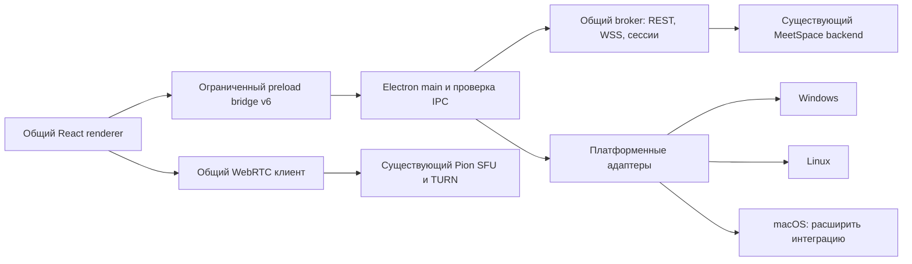

# MeetSpace Desktop: аудит и архитектура macOS

Дата: **28 октября 2026 года**. Этап: **01 — аудит, без реализации порта**.

## 1. Вывод и границы проверки

Текущий Electron + React + TypeScript проект подходит для macOS. Отдельный frontend, отдельный клиент Pion/SFU или новая серверная реализация не нужны. Следует сохранить общие интерфейс, авторизацию, REST, WebSocket, медиаклиент и мастер SSH, расширив существующий платформенный слой и добавив отдельную сборку macOS.

**Подтверждено:** общий проект собирается; базовый интерфейс запускается из исходников на локальном Mac ARM64; проверки изоляции renderer и маршрутизации проходят. **Не подтверждено:** готовность распространяемой `.app`, аппаратные звонки, системные разрешения, подписанный выпуск, совместимость всех целевых ОС. DMG/ZIP в этом этапе не создавались и не публиковались.

Проверен рабочий каталог `/Users/aleksandranickij/htdocs/meet_space_windows`, ветка `main`, origin `https://github.com/janickiy/meet-space-desktop`, HEAD `88107709dd896a8839cd1ac59bee649240a18ae6` (`Record verified 0.2.1 beta release and landing delivery`). Проверки относятся к фактическому рабочему дереву, а не исключительно к этому коммиту: до аудита в нём уже были изменения поддержки вложений:

- `desktop/tests/electron-product.cjs`;
- `desktop/tests/fixtures/https-fixture.cjs`;
- `desktop/tests/fixtures/product-fixture.cjs`;
- `desktop/tests/product-attachment-checks.cjs` — новый файл;
- `frontend/scripts/check-desktop-foundation.mjs`;
- `frontend/src/attachment-formats.json`.

Эти изменения сохранены. Backend, версии зависимостей и production-код в рамках этапа 01 не менялись. Подключение к рабочим аккаунтам, отправка сообщений, переустановка сервера и изменение системных разрешений не выполнялись.

## 2. Фактическая техническая база

| Компонент | Проверенное значение |
| --- | --- |
| Версия Desktop и frontend | `0.2.1-beta` |
| Electron | `44.9.3` |
| Chromium внутри Electron | `152.0.7977.167` |
| Node.js внутри Electron | `24.22.0` |
| Node.js, использованный локально для сборки и unit-тестов | `24.19.0`, ARM64 |
| Node.js, закреплённый в CI | `24.22.1` |
| electron-builder / TypeScript | `26.17.0` / `7.0.2` |
| React / Vite | `19.3.0` / `8.3.5` |
| Runtime-зависимости main | `ssh2 1.17.0`, `ws 8.22.0` |
| Lockfiles | npm `package-lock.json`, формат 3 |
| Локальная ОС | `sw_vers`: macOS `27.2`, build `26B123`; `uname -m`: `arm64` |
| Инструменты Apple | Command Line Tools; `clang`, `notarytool`, `stapler` доступны |
| Подпись на этой машине | `security find-identity -v -p codesigning`: **0 действительных identities** |

Источники версий: [desktop/package.json](../../desktop/package.json), [frontend/package.json](../../frontend/package.json), lockfiles, установленный Electron и его runtime probe. Версии встроенных компонентов также сверены с [релизом Electron 44.9.3](https://releases.electronjs.org/release/v44.9.3). Наличие Apple Developer account и реквизитов notarization не проверялось.

В `Electron.app/Contents/Info.plist` указан `LSMinimumSystemVersion=13.0`. Electron 44 прекратил поддержку macOS 12; это нижняя граница runtime, а не подтверждение совместимости MeetSpace. Для продукта предлагается минимум **macOS 15** согласно заданной матрице. Обновлять Electron одновременно с первоначальным портированием без отдельной причины не требуется. [Изменения Electron 44](https://www.electronjs.org/blog/electron-44-0).

## 3. Матрица целевых систем

| Цель | Основание | Доступность в проверенной среде | Фактическая проверка MeetSpace |
| --- | --- | --- | --- |
| macOS 15 Sequoia, Intel x64 | Apple поддерживает соответствующие Intel Mac | Intel Mac с этой ОС не обнаружен | Не выполнялась |
| macOS 15 Sequoia, Apple Silicon ARM64 | Целевая конфигурация поддерживаемых Mac | Такая ОС не обнаружена | Не выполнялась |
| macOS 26 Tahoe, ARM64 | Целевая конфигурация поддерживаемых Mac | Такая ОС не обнаружена | Не выполнялась |
| macOS 27 Golden Gate, ARM64 | Название сверено с официальными страницами Apple | Локальный Mac сообщает `27.2 / 26B123`, ARM64 | Сборка и базовый запуск из исходников; без пакетной и аппаратной приёмки |

Официальные источники: [Sequoia](https://support.apple.com/en-us/120282), [Tahoe](https://support.apple.com/en-euro/122867), [macOS 27 Golden Gate](https://www.apple.com/os/macos/), [совместимые с macOS 27 компьютеры](https://support.apple.com/en-us/127255). Название Tahoe не переносится на macOS 27. Строка `27.2` выше — результат локальной команды, а не самостоятельное утверждение о канале или публичной доступности конкретного обновления Apple.

В UTM обнаружены остановленные Windows 11 ARM64 и Ubuntu 24.04 ARM64. Они не заменяют macOS-стенды. Rosetta или кросс-сборка x64 на ARM64 также не подтверждают работу на Intel Mac. Для принятия порта нужны все четыре строки матрицы, включая первый запуск подписанного приложения и разрешения устройств.

## 4. Существующая архитектура и переиспользование

| Слой | Фактические файлы и поведение | Решение для macOS |
| --- | --- | --- |
| React UI | `frontend/src`, общие страницы, компоненты и стили | Переиспользовать; платформенные подписи и capabilities передавать через существующий контракт |
| Main / BrowserWindow | `desktop/src/main.ts`: локальный `app://meetspace`, sandbox, context isolation, Node/webview выключены | Сохранить модель; изменить только системное меню и жизненный цикл окна |
| Preload / IPC | `desktop/src/preload.ts`: замороженный bridge v6; main проверяет sender, окно и основной frame | Не добавлять произвольный `invoke`, shell или файловый доступ |
| REST / авторизация | `desktop/src/broker.ts`, `network/*`, `session/*`: настоящий JWT в main; renderer получает opaque `desktop-session:<UUID>` | Переиспользовать API, identity/epoch и правила TLS |
| WebSocket | `frontend/src/realtime.ts`, `personalRealtime.ts`, `desktop/src/network/ws-runtime.ts` | Переиспользовать; проверить сон, смену сети, reconnect и смену аккаунта |
| Сессии / credentials | `platform/credential-store.ts`: Keychain уже выбран для Darwin; `session/vault.ts`: зашифрованный файл, атомарная запись | Проверить подписанную identity, добавить macOS-восстановление доступа |
| WebRTC / Pion | `frontend/src/media.ts`, `mediaDevices.ts`, `remotePlayback.ts`, `useMedia.ts` | Сохранить ICE/TURN, BUNDLE, Opus/VP8 и lifecycle; добавить системные разрешения |
| Захват экрана | `desktop/src/media-permissions.ts`, `platform/display-capture.ts`: управляемый выбор источника | Расширить диагностикой macOS и отдельно исследовать системный picker/звук |
| Вложения / записи | `frontend/src/platform/transport.ts`, `desktop/src/downloads.ts` | Сохранить ограничения и нативное сохранение; проверить macOS-диалоги |
| Deep links | `security.ts`, ранний `open-url` в `main.ts`, очередь до готовности UI | Переиспользовать parser; проверить регистрацию схемы в установленной `.app` |
| Установка сервера по SSH | Существующий main-контроллер и общий мастер | Переиспользовать без переноса SSH в renderer или добавления backend в Desktop |
| Нативная оболочка | `native-shell.ts`, `native-notifications.ts`, `platform/*` | Расширить существующие интерфейсы платформенной реализацией macOS |
| Сборки / обновления | Windows NSIS и Linux DEB/RPM/AppImage, Windows trust verifier | Добавить отдельный macOS driver, подпись и проверку; Windows verifier не использовать для `.app` |

Ключевые свойства, которые должны сохраниться:

- Прямой удалённый доступ renderer к API ограничен; авторизованные REST/WSS проходят через main. WebRTC media остаётся в общем медиаклиенте.
- Смена сервера/аккаунта инвалидирует устаревшие операции. JWT и refresh cookies не попадают в web storage.
- Хранилище использует атомарную запись с правами `0600/0700`; временная недоступность не должна удалять старый vault. Plaintext fallback запрещён, включая Linux `basic_text`.
- Deep link разрешает только предусмотренные маршруты `meetspace://open/...`, без произвольных команд, серверов, токенов, query/hash.
- Upload ограничен 10 MiB, ответ IPC — 16 MiB, очередь потока — 256 KiB. Нативное скачивание ограничено 2 GiB и четырьмя задачами, пишет `.part` перед rename; приватное воспроизведение использует opaque handles.
- При выходе освобождаются медиаресурсы, соединения, загрузки, уведомления и SSH-контроллер. Существуют обработчики suspend/resume.

Эти выводы получены из текущего клиентского кода. Новая проверка контрактов на работающем backend и реальные звонки в рамках аудита не выполнялись; подтверждённой необходимости изменения backend не найдено.

## 5. Что представляет собой decs_maket

Проверен `/Users/aleksandranickij/htdocs/decs_maket`, commit `857d9770117328b01f5d625cd7a64e3f080fdd26` (`Refine meeting information dialog`). Это статический интерактивный браузерный прототип: `index.html`, CSS, `app.js`, `calls.js`, `personal-call.js`, `accounts.js`, `chat-actions.js`, `chat-enhancements.js`, `recording-library.js`, `installer.js` и вспомогательные файлы. В нём нет React-проекта или production API-клиента. Данные, звонки и установка демонстрируются локальными fixtures, localStorage и сценариями прототипа.

Назначение: эталон размеров, цветов, шрифтов, иконок, отступов, состояний и поведения интерфейса. Его демоданные, имитацию авторизации, прогресса SSH и звонков нельзя переносить в production вместо существующей логики. Общий React должен воспроизводить макет для всех платформ; стандартные системные кнопки macOS и сочетания клавиш адаптируются отдельно. Мастер установки остаётся общим, с уже принятыми пользовательскими изменениями.

Лицензирование и происхождение:

| Материал | Что найдено | Решение |
| --- | --- | --- |
| Собственный дизайн, тексты, логотипы макета | Отдельный общий LICENSE/NOTICE в каталоге не найден; README не устанавливает открытую лицензию | Использование поручено владельцем проекта; перед внешним выпуском зафиксировать происхождение этих ресурсов, не объявлять весь макет open source |
| Inter | В макете локальные Latin/Cyrillic WOFF2 400/600; установленный `@fontsource/inter` содержит OFL 1.1 | Использовать проверенный пакет и сохранять OFL; совпадение происхождения каждого WOFF2 макета не доказано |
| Иконки | В макете `icons.js` с inline SVG; production использует `lucide-react` | Сохранять production-библиотеку и notices: ISC, а для производных Feather — MIT |
| QR | Заголовок генератора макета и `frontend/src/vendor/LICENSE` указывают Nayuki MIT | Сохранять атрибуцию; не удалять лицензию при повторном использовании |
| Приложение | `license: UNLICENSED`, собственные APP-LICENSE / TEST-LICENSE | Не интерпретировать как разрешение свободного распространения исходников |

`desktop/resources/THIRD_PARTY_NOTICES.txt` уже содержит Inter, Lucide и Nayuki. Его и лицензии необходимо включать в macOS-пакеты, как в существующие поставки.

## 6. Матрица возможностей macOS

«Есть в коде» здесь не означает «принято на macOS».

| Возможность | Сейчас | Что проверить / добавить |
| --- | --- | --- |
| Запуск renderer, IPC, навигация | Базовый запуск ARM64 прошёл | Установленная подписанная `.app` на всех целевых ОС |
| Темы, масштаб, интерфейс | Проверены переключение состояния темы и отсутствие горизонтального переполнения при zoom | Стабильные кадры light/dark, контраст, Retina, окна разных размеров, сравнение разделов с макетом |
| REST/WSS и вход | Общая реализация | Реальный вход, refresh/logout, offline и смена сервера/аккаунта |
| Keychain | Darwin-адаптер есть | Первый доступ, отказ, lock/unlock, обновление приложения с прежней identity, восстановление после ошибки |
| Камера / микрофон | Общий getUserMedia есть; macOS TCC-адаптера нет | Usage descriptions, запрос по действию пользователя, отказ и повторное разрешение |
| Динамики / устройства | Общая очередь setSinkId и fallback | CoreAudio, default output, USB/Bluetooth, отключение и возврат устройств |
| Экран / окно | Darwin направляется в custom picker | Screen Recording permission, отмена, исчезновение источника, Stop и очистка tracks |
| Системный звук при показе экрана | **Явно отключён для Darwin** | Отдельный runtime-прототип и приёмка; до них capability остаётся false |
| Уведомления / звук | Общая доставка, приватность, дедупликация есть | Разрешение macOS, Focus, звук в фоне, клик после скрытия окна, отсутствие дублей |
| Закрытие окна / Dock | Текущий close обычно завершает приложение | Mac-политика: закрытие окна, Cmd+W, Cmd+Q, Dock activate, reopen |
| Menu bar / Dock badge | Общий цветной tray; tooltip непрочитанных | Template-иконки Retina, стандартное app-menu, badge |
| Автозапуск | **На Darwin выключен** | Mac StartupProvider и реальная проверка Login Items |
| Deep link | `open-url` и очередь есть, проверка при reload прошла | Cold/warm launch через зарегистрированную схему установленного пакета |
| Файлы / записи / clipboard | Общие защищённые пути; clipboard — `navigator.clipboard.writeText` | Нативные Save/Open, Unicode, отмена, отказ записи, очистка `.part` |
| Упаковка / подпись / notarization | **Не реализованы** | Отдельные ARM64/x64 DMG/ZIP, Developer ID, hardened runtime, нотариализация |
| Автообновление | **На Darwin выключено** | Первоначально ручное обновление; позднее отдельный доверенный Mac updater |

## 7. Пробелы и минимальные адаптеры

### 7.1. Системные разрешения и медиа — до первого полноценного теста звонка

`MediaPermissions` проверяет доверенный renderer, но не системное состояние TCC. Нет вызовов `systemPreferences.getMediaAccessStatus` / `askForMediaAccess`, usage descriptions камеры, микрофона и системного аудио. Нужен небольшой `platform/macos/media-access.ts`, вызываемый через текущую медиаполитику, с состояниями `not-determined`, `granted`, `denied`, `restricted`, `unknown`.

Камеру/микрофон запрашивать только по соответствующему действию пользователя. Для отказа показывать конкретный путь в System Settings; не повторять запрос бесконечно. Для экрана нет аналогичного `askForMediaAccess('screen')`: системный статус и запуск захвата обрабатываются отдельно. Добавить `NSCameraUsageDescription`, `NSMicrophoneUsageDescription`; для реализации системного звука — `NSAudioCaptureUsageDescription`. [API systemPreferences, закреплённый Electron 44.9.3](https://raw.githubusercontent.com/electron/electron/v44.9.3/docs/api/system-preferences.md).

Базовый custom picker уже проверяет user gesture, владельца/mainframe, timeout, выбранный источник и отмену. Сохранить эти гарантии, добавить понятную причину отказа при недоступном Screen Recording вместо молчаливой отмены. `useSystemPicker` в закреплённой документации экспериментален, доступен на macOS 15+ и обходит custom handler; его нельзя включить одним флагом без проверки прежних гарантий. [API session 44.9.3](https://raw.githubusercontent.com/electron/electron/v44.9.3/docs/api/session.md).

Документация `desktopCapturer` описывает CoreAudioTap на macOS 14.2+ и риск «мёртвой» аудиодорожки без usage description. В то же время описание callback loopback в `session` остаётся Windows-only. Это требует отдельной проверки именно Electron 44.9.3: наличие API не доказывает работающий звук. [desktopCapturer 44.9.3](https://raw.githubusercontent.com/electron/electron/v44.9.3/docs/api/desktop-capturer.md), [разрешения Screen & System Audio Recording у Apple](https://support.apple.com/guide/mac-help/control-access-screen-system-audio-recording-mchld6aa7d23/mac).

Общий fallback устройств уже ограничен NotFound/Overconstrained и не маскирует отказ разрешения или занятость устройства. Очередь setSinkId, muted до маршрутизации remote audio и освобождение tracks должны остаться общими. Приёмка: macOS↔Windows и macOS↔Linux, direct/relay ICE, mute/unmute, unplug, reconnect, сон, запрет захвата после Stop.

### 7.2. Окно, меню, уведомления и автозапуск

`native-shell.ts` перехватывает close и вызывает quit, если `closeToTray` выключен; default — false. Поэтому существующий Darwin guard в `window-all-closed` сам по себе не обеспечивает ожидаемое поведение Mac.

Минимальное решение — Mac-политика скрытия главного окна по красной кнопке/Cmd+W, сохранение Dock, сессии и фоновой доставки; Cmd+Q вызывает общий безопасный выход. Это не должно зависеть от наличия menu bar icon. Если позднее окно будет уничтожаться, нужен единый `ensureMainWindow()` для Dock, tray, deep link и notification click: сейчас `activate` умеет пересоздавать окно, а `NativeShell.show()` — нет. Звук уведомлений поступает в renderer, поэтому уничтожение окна без замены этого пути потеряет фоновый звук.

Добавить Darwin-ветку создания меню со стандартными ролями About / Services / Hide / Hide Others / Unhide и явным выходом. Для menu bar нужны монохромные `TrayTemplate.png` и `@2x`, template semantics; текущий цветной PNG 18×18 подходит не для всех системных тем. Dock badge следует обновлять из существующего счётчика непрочитанных. `Notification.isSupported()` не означает, что пользователь разрешил уведомления: требуются реальные проверки разрешения, Focus и звука.

Расширить существующий `StartupProvider` из `platform/autostart.ts` реализацией macOS. Не использовать Windows-поле `executableWillLaunchAtLogin` как критерий на Mac. Регистрация только после явного переключения пользователем; учитывать отзыв Login Item в System Settings. Переключатели Windows/Linux и их текущая семантика сохраняются.

Для renderer достаточно существующего platform contract: подсказки `⌘K` вместо жёсткого `Ctrl K`, корректные сведения о поддерживаемых возможностях. Нативную рамку и стандартные кнопки окна Mac сохранять; создавать отдельные React-страницы для ОС не требуется.

### 7.3. Keychain и версия ОС

`platform/credential-store.ts` уже выбирает Keychain. Нужны Mac-тексты восстановления в `DesktopSessionGate.tsx`, проверка stable bundle identity и подписанного приложения: login → перезапуск → обновление; отказ пользователя; lock/unlock; повреждение vault. Не удалять сессии при временной недоступности, не переходить на открытое хранение и не сбрасывать системную связку автоматически.

Сейчас `Cipher` и vault используют синхронный safeStorage. Установленные typings 44.9.3 содержат sync и async API; текущий sync-путь не является доказанным блокером этого runtime. Однако официальная документация описывает deprecation sync в 45 и удаление в 46. Плановая миграция должна охватить Cipher/vault и порядок атомарных записей; синхронный Keychain prompt способен блокировать main. Это отдельный риск следующего обновления Electron. [Electron safeStorage](https://www.electronjs.org/docs/latest/api/safe-storage).

Проверка платформы в `main.ts` пропускает любой Darwin x64/ARM64, а `HostPlatform.osRelease` содержит версию ядра. Нужна Mac-проверка продуктовой версии, согласованная с `minimumSystemVersion=15.0` в пакете, и понятное сообщение о неподдерживаемой ОС. Нельзя сравнивать номер Darwin kernel с номером macOS.

## 8. Сборка, выпуск и распространение

### 8.1. Почему существующий Windows driver нельзя просто запустить с --mac

- `desktop/scripts/package.mjs` жёстко вызывает `--win nsis`; macOS scripts/config отсутствуют.
- `electron-builder.config.cjs` задаёт Windows-имена артефактов и `normalize-package.cjs` в `afterPack` и `afterSign`.
- Этот normalizer отвергает **все symlink**, а Electron Framework в macOS bundle использует штатные symlink. Он не подходит для `.app`.
- Изменение содержимого bundle после подписи недопустимо; macOS-нормализация должна завершаться до signing.
- Общий `build.mjs` безусловно подготавливает NSIS patch. Его следует перенести в Windows packaging или ограничить Windows-веткой.
- `.icns`, entitlements, macOS notarization и macOS CI сейчас отсутствуют.

Предлагаемые новые файлы: `desktop/electron-builder.macos.config.cjs`, `desktop/scripts/package-macos.mjs`, `desktop/resources/macos/` с `.icns`, template icons и entitlements, отдельный verifier пакета. Общий payload можно выделить из существующей конфигурации, сохранив Windows/Linux настройки и их проверки.

Сначала выпускать **отдельные x64 и ARM64 DMG + ZIP**. Universal bundle отложить до приёмки обеих архитектур. `runtime-policy.cjs` уже исключает собственные `.node`, `cpu-features`, `nan` и buildcheck, использует JavaScript fallback ssh2 и `npmRebuild:false`. Обязательного собственного native addon сейчас нет, но Electron, helpers и frameworks всё равно должны проверяться по Mach-O архитектуре.

### 8.2. Identity и доверие

Сохранить отображаемое имя **MeetSpace**. Планировать постоянные bundle IDs по каналу на базе существующих `com.janickiy.meetspace.desktop` и `.test`; тестовые и пользовательские профили не смешивать случайно. Нужны Developer ID Application, hardened runtime, минимально необходимые entitlements, notarization и stapling. После этого проверить подпись вложенного кода и Gatekeeper, первый запуск скачанного приложения с quarantine. Отключение Gatekeeper или удаление quarantine не являются процедурой выпуска. [Electron: code signing](https://www.electronjs.org/docs/latest/tutorial/code-signing), [electron-builder macOS](https://www.electron.build/mac.html), [Apple notarization](https://developer.apple.com/documentation/security/notarizing-macos-software-before-distribution).

Текущая release policy намеренно Windows-only: Authenticode/store/PFX, Windows thumbprint, два NSIS PE-файла, stable `x.y.z`, запрет beta в этом пути. Нельзя ослаблять её ради macOS beta. Следует отдельно описать platform signing identity и beta/stable channel, сохранив существующие Windows ограничения. Локально нет действительного signing identity; готовность к подписанному выпуску не подтверждена.

`updates.ts` выключает обновления на Darwin; policy/verifier используют Windows feed, `.exe` и PowerShell Authenticode. Первый macOS выпуск может обновляться вручную через подписанный DMG. Для последующего автообновления нужен отдельный MacUpdateAdapter с проверками Team ID, подписи, версии, архитектуры, канала и SHA-256, сохранением пользовательского согласия и проверкой заменяемой `.app`.

### 8.3. CI и каталог пакетов

Существующие workflows:

| Workflow | Назначение и граница доказательств |
| --- | --- |
| `desktop-build.yml` | Windows x64/ARM64; закреплённые actions, Node, source hash, тесты, NSIS payload/evidence |
| `desktop-candidate.yml` | Отдельный защищённый путь подписанного Windows candidate |
| `desktop-acceptance.yml` | Стенды Win10 22H2 x64 и Win11 x64/ARM64 |
| `desktop-linux-build.yml` | Native Ubuntu 22.04 x64/ARM64, DEB lifecycle и AppImage с системной изоляцией; Fedora 44 RPM lifecycle в контейнере не заменяет Fedora GUI |

Добавить отдельный macOS workflow с native x64 и ARM64. Актуальные labels runner и доступные версии macOS проверить при реализации; не принимать label runner за подтверждение всей OS-матрицы. Переиспользовать `source-inputs.mjs`, lockfiles, source hash, SBOM и checksums. `collect-build-evidence.mjs` сейчас Windows-only: его общую часть можно выделить, а Mac-проверки добавить отдельно. PR-сборки не должны получать signing secrets; signing/notarization выполняются в защищённом release-процессе.

На дату аудита `source/catalog.json` содержит 98 пакетов: Windows 26, Linux 72, macOS 0; latest — `0.2.1-beta`. В `.gitattributes` предусмотрены exe/deb/rpm/AppImage, но нет DMG/ZIP. Для этапа выпуска предлагается `source/macos/<version>/{x64,arm64}/` с пакетами и SHA-256, соответствующие LFS-правила, каталог и выбор macOS на лендинге. Эти изменения и публикация не выполняются в этапе 01.

## 9. Реально выполненные проверки

Локальные логи находятся в gitignored-каталоге [desktop/artifacts/macos-stage01-20261028](../../desktop/artifacts/macos-stage01-20261028/). Они доступны в этом checkout, но не входят в исходный репозиторий. Команды выполнялись с установленным Node из Codex runtime; зависимости не обновлялись.

| Проверка | Результат | Доказательство / ограничения |
| --- | --- | --- |
| `npm --prefix desktop test` | **330 PASS, 0 FAIL, 1 SKIP** из 331 | [desktop-tests.log](../../desktop/artifacts/macos-stage01-20261028/desktop-tests.log); skip — Linux GIO Desktop Entry, недоступный на macOS |
| `npm --prefix frontend run check:desktop-foundation` | **30/30 PASS** | [frontend-foundation.log](../../desktop/artifacts/macos-stage01-20261028/frontend-foundation.log); включает уже существующие изменения вложений |
| `npm --prefix frontend run check:desktop-media` | **39/39 PASS** | [media-check.log](../../desktop/artifacts/macos-stage01-20261028/media-check.log); подставные tracks/RTCPeerConnection, не аппаратный звонок |
| `npm --prefix frontend run check:desktop-assets` | **9/9 PASS** | [frontend-assets.log](../../desktop/artifacts/macos-stage01-20261028/frontend-assets.log) |
| `npm --prefix desktop run build` | **PASS** | [desktop-build.log](../../desktop/artifacts/macos-stage01-20261028/desktop-build.log); TypeScript main и renderer/Vite, не DMG/ZIP |
| Scoped build/release/Linux package policy tests | **24 PASS, 0 FAIL** | Подмножество общей desktop suite; не прибавлять к 330 |
| Electron runtime probe | **PASS, darwin/arm64** | Подтверждены версии встроенных Chromium/Node без media-захвата |
| Electron smoke с временным профилем | **PASS, darwin/arm64, Electron 44.9.3** | [electron-smoke.log](../../desktop/artifacts/macos-stage01-20261028/electron-smoke.log), [локальная обёртка](../../desktop/artifacts/macos-stage01-20261028/isolated-smoke.cjs) |

Smoke использовал существующий `desktop/tests/electron-smoke.cjs`, с временными `userData` и `sessionData`, заданными до загрузки main, и таймаутом 60 секунд. Проверены local renderer, переход welcome→connection, ограниченное меню, sandbox/Node isolation, bridge, отказ всех пяти update IPC без записи update cache, запрет внешнего URL, удалённой сети renderer, inline script, navigation/window-open, отказ неавторизованного API, отсутствие credentials в web storage, переключение системной темы, zoom 1.25/1.5/2 без горизонтального переполнения и очередь deep link при reload.

Этот запуск создавал временные menu/tray и проверял доступность настоящего safeStorage. Вход и шифрование пользовательской сессии не выполнялись; временные профили удалены. Это не тест Keychain login и не регистрация deep link установленного пакета.

В логе есть диагностическое `sandbox_extension_issue_file ... Electron Helper.app ... Operation not permitted`; тест завершился успешно. Причина предупреждения не установлена, оно подлежит повторной проверке на packaged `.app`. Сообщение `Link is not allowed` получено ожидаемо в отрицательной проверке внешней ссылки. Изоляция не отключалась.

Просмотрены снимки [light](../../desktop/artifacts/foundation-darwin-arm64-light.png) и [dark](../../desktop/artifacts/foundation-darwin-arm64-dark.png). На снимке с именем light кнопки имеют тёмный фон и недостаточный контраст текста; второй кадр показывает светлую форму. Harness ожидает обновление theme dataset, но не доказывает завершение отрисовки. Поэтому функциональный PASS темы не считается визуальной приёмкой: требуется дождаться стабильного кадра и проверить фактическую тему/контраст. Причина CSS или захвата кадра пока не определена.

Не выполнялись: macOS package install/update/uninstall, signing/notarization/Gatekeeper; реальный login и Keychain recovery; TCC Allow/Deny; камера, микрофон, CoreAudio, Bluetooth, экран и системный звук; реальные REST/WSS/SFU/SSH сценарии; длительные замеры CPU/RAM и утечек; повторная GUI-приёмка Windows/Linux. Существование теста в проекте не учитывается как его выполнение.

## 10. Регрессия Windows/Linux и критерии следующих этапов

В этом этапе изменения ограничены документацией; production-код, зависимости и настройки сборок сохранены. Сверка SHA-256 с начальным снимком 514 файлов показала изменение только `docs/README.md`; отчёт добавлен новым файлом. Общие тесты и сборка прошли, включая Windows release policy и Linux package policy. Это не новая нативная приёмка Windows/Linux: UTM-гости не запускались.

При следующих изменениях обязательны:

1. **Windows 10 22H2 x64, Windows 11 x64/ARM64:** close/close-to-tray, восстановление окна, уведомления и звук, точный путь автозапуска, DPAPI, NSIS upgrade/uninstall и подпись.
2. **Linux x64/ARM64:** при недоступном tray окно не исчезает; X11/Wayland, portal/PipeWire, desktop-entry startup, Keyring/KWallet, запрет basic_text; DEB/RPM/AppImage lifecycle и системная изоляция.
3. **Все платформы:** IPC из чужого окна/frame отклоняется; CSP/TLS/URL allowlist не ослаблены; logout не возвращает старые cookies; смена аккаунта отменяет старые операции; безопасные upload/download; утечки tracks/таймеров/сокетов после повторных входов и звонков.
4. **macOS:** red close/Cmd+W/Cmd+Q, Dock/menu bar/deep link/notification reopen, fullscreen/Spaces/мониторы, холодный и повторный запуск, Keychain identity, TCC, настоящие устройства и звонки с Windows/Linux на всех целевых ОС.
5. **Дизайн:** сравнивать одинаковые состояния и размеры с `decs_maket`, включая реальные чаты, комментарии встречи, записи, настройки и модальные окна. Не заменять реальные данные fixtures ради похожего снимка; отдельно проверять тёмную тему, масштаб и доступность управления клавиатурой.

## 11. План минимальных изменений по этапам

| Этап | Объём | Критерий завершения |
| --- | --- | --- |
| 01 — текущий аудит | Архитектура, reuse/capability/OS matrices, ограничения и проверенная база | Этот отчёт; остановка без реализации |
| 02 — Electron/UI | Darwin platform/version policy, окно/меню/сочетания, общие UI capabilities; минимальная `.app` для разработки | Общий UI запускается, shared regression проходит; отсутствует отдельный macOS frontend |
| 03 — WebRTC/media | Общая медиалогика + TCC camera/microphone adapter и вывод звука | Реальные direct/relay звонки, смена устройств и очистка ресурсов |
| 04 — Screen/permissions | Screen Recording UX, безопасный выбор источника; исследование системного picker и аудио | Allow/Deny/Cancel/Stop, исчезновение окна и отсутствие скрытого захвата |
| 05 — OS integration | Завершение Keychain UX/identity, menu bar/Dock, notifications, StartupProvider, deep links | Реальные сценарии установленного приложения, восстановление после сна/сети |
| 06 — Release/packaging | DMG/ZIP x64/ARM64, подпись/notarization, CI/evidence/catalog/landing; определённый режим обновления | Проверенные скачанные пакеты и защищённая публикация, без ослабления Windows policy |
| 07 — Final QA | Вся матрица ОС, длительные звонки, ресурсы, безопасность, визуальная и Win/Linux регрессия | Отчёт с фактическими результатами; непроверенные сочетания не объявляются поддержанными |

Расширять существующие `host-platform`, `credential-store`, `autostart`, `display-capture`, `native-shell` и `media-permissions`. Новые небольшие macOS-модули вводить только для TCC, системного меню/поведения и Login Items. Новая общая «платформенная система» поверх уже существующей не требуется. Packager и update trust — отдельные платформенные реализации с общими входами и доказательствами сборки.

Для следующих этапов нужны Intel Mac с Sequoia 15, ARM64-стенды Sequoia 15/Tahoe 26, доступ к реальным аудио/видеоустройствам и подписывающая identity перед выпуском. Локальный macOS 27 ARM64 пригоден для разработки и части проверок, но не закрывает остальные конфигурации.

## 12. Файлы, изменённые в этапе 01

- `docs/macos/01_ARCHITECTURE_AUDIT.md` — этот отчёт.
- `docs/README.md` — ссылка на macOS-аудит.

Логи, временная smoke-обёртка и снимки находятся в игнорируемом `desktop/artifacts/`; они не являются production-изменениями. Исходные шесть изменений вложений не входят в данный этап. **Этап 01 завершён; реализация следующих этапов не начиналась.**
