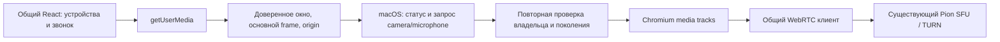

# Этап 03 — WebRTC, камера, микрофон и аудиоустройства macOS

Дата: **28 октября 2026 года**. Версия исходников: **0.2.1-beta**. Продолжение [этапа 02](02_ELECTRON_UI.md) в существующем Electron/React-проекте. Предыдущие изменения интерфейса и вложений сохранены. Backend и медиастек не переписывались.

## Результат и устройство решения

Добавлен macOS-адаптер системных разрешений камеры/микрофона, подключённый к существующей политике доверенного renderer. Общий клиент продолжает использовать RTCPeerConnection, ICE/STUN/TURN, Opus/VP8, действующие сигнализацию и Pion/SFU. В macOS `.app` добавлены пояснения доступа к камере и микрофону. Системный звук и демонстрация экрана остаются отдельным этапом 04.

План перед реализацией: сохранить общий медиапуть, добавить TCC-адаптер и обработку отказов, проверить выбор/отключение устройств и очистку ресурсов, выполнить доступные аппаратные и многопользовательские тесты на текущем Mac. Макеты `decs_maket` используются как прежний визуальный эталон; их фиктивная медиалогика не переносится в приложение.

## Реализованные изменения

| Область | Поведение |
| --- | --- |
| `MacOSMediaAccess` | Статусы `not-determined/granted/denied/restricted/unknown`; native request только при первом обращении; повторная проверка результата |
| Одновременные запросы | Запросы одного вида объединяются, разрешение не кэшируется как постоянное |
| Отказ / ошибка системы | Доступ закрывается; denied/restricted/unknown не вызывают повторный prompt и не заменяются другим устройством |
| Владелец запроса | До обращения к TCC проверяются trusted WebContents, основной frame и origin; после ожидания проверяются повторно |
| Отмена | Навигация, скрытие/закрытие окна, смена identity, suspend и quit инвалидируют ожидающее разрешение |
| Доставка callback | Финальная проверка владельца/epoch и Electron callback выполняются синхронно в одном участке; закрытие между microtasks не выдаёт запоздалый grant |
| Display-only `mediaTypes:[]` | Не запрашивает камеру или микрофон; прежний отдельный display handler сохраняется |
| Файлы `.app` | `NSCameraUsageDescription`, `NSMicrophoneUsageDescription`; проверка реального plist после упаковки |
| UX macOS | Отказ объясняет путь «Системные настройки → Конфиденциальность и безопасность → Камера/Микрофон» и повторный запуск через ⌘Q при необходимости |
| Раннее отключение input | Если capture promise вернул уже завершённую или неполную дорожку, останавливаются все полученные tracks; устройство не показывается включённым и другое автоматически не захватывается |

`MediaPermissions.request` сохраняет синхронную проверку allowlist. Новый `authorizeRequest` соответствует callback-контракту Electron и проводит асинхронное системное разрешение до ответа. Отдельные unit-тесты воспроизводят отмену именно между разрешением promise и следующей microtask: callback получает false. Исключение при доставке в уже закрытый документ не вызывает второй ответ.

Синхронный permission check допускает `not-determined`, чтобы первый запрос дошёл до асинхронного native prompt; сам по себе этот check не считается полученным системным согласием. Реальное разрешение выдаётся после `ensure` и повторных проверок. Адаптер не сбрасывает TCC, не изменяет системные настройки и не использует обходные флаги.

Для изолированных тестов синтетических устройств добавлен явный in-process `mediaAccess` seam. Packaged-приложение его игнорирует, CLI/env/renderer его не выбирают. Fake-device тесты продолжают проходить через trusted permission policy, но не обращаются к настоящим камере/микрофону и не считаются проверкой native consent.

## Выбор устройств, отключения и восстановление

Сохранены общий список `enumerateDevices`, `devicechange`, выбор camera/audioinput, noise suppression и очередь `routeAudioOutput`. Выбор недоступного сохранённого input может перейти к системному устройству только для NotFound/Overconstrained. Отказ доступа, занятость или уже завершившаяся дорожка не запускают автоматическую попытку другого capture.

Вывод звука использует `HTMLMediaElement.setSinkId`, когда доступен. Маршрутизация сверяется со списком устройств; при исчезновении выбранного выхода используется системный default. Устаревшая операция не должна сбросить более новый выбор гарнитуры. Проверка динамика уже использовала этот общий путь, её реализация не заменялась.

USB/Bluetooth-устройства проходят через системные input/output IDs и те же обработчики. Настоящей USB/Bluetooth-гарнитуры в текущем inventory не было: её работа, профиль Bluetooth при включении микрофона и отключение во время звонка требуют отдельной аппаратной приёмки.

Существующие suspend/pagehide/quit освобождают захват и соединения. После lifecycle release старое намерение захвата не восстанавливается автоматически; камера/микрофон включаются явно. При обычном сетевом reconnect сохраняется состояние mute. Peer cleanup, смена источников и повторный join/leave проверены тестами ниже. Физический сон Mac и реальная смена Wi-Fi/проводной сети не выполнялись.

## Проверенная среда и матрица ОС

Локальный стенд: **macOS 27.2.0 ARM64**, Electron **44.9.3**, Chromium **152.0.7977.167**, Node для тестов **24.19.0**, Go toolchain **1.26.9**. Официальное название macOS 27 — Golden Gate; источники и границы матрицы зафиксированы в [аудите](01_ARCHITECTURE_AUDIT.md).

| Целевая ОС | Результат этого этапа |
| --- | --- |
| macOS 15 Sequoia Intel x64 | Стенд отсутствует; runtime и физические устройства не проверены |
| macOS 15 Sequoia ARM64 | Стенд отсутствует |
| macOS 26 Tahoe ARM64 | Стенд отсутствует |
| macOS 27 Golden Gate ARM64 | Нативные встроенные устройства, Chromium/Pion, direct/relay, lifecycle и сборка проверены |

Результат ARM64 на macOS 27 не переносится на остальные строки. Cross-built x64 не считается проверкой Intel.

## Реальные результаты проверок

Логи находятся локально в gitignored [desktop/artifacts/macos-stage03](../../desktop/artifacts/macos-stage03/). Тесты не обращались к рабочим аккаунтам и не создавали комнат на внешнем сервере.

| Проверка | Результат и доказательство |
| --- | --- |
| Полная Desktop suite | **362 PASS, 0 FAIL, 1 SKIP** из 363; skip — Linux GIO на Mac; [desktop-tests.log](../../desktop/artifacts/macos-stage03/desktop-tests.log) |
| TCC и permission policy | **33/33 PASS**, входят в общую suite; [permissions-unit.log](../../desktop/artifacts/macos-stage03/permissions-unit.log) |
| Frontend foundation | **30/30 PASS**; [foundation.log](../../desktop/artifacts/macos-stage03/foundation.log) |
| Frontend media lifecycle | **45/45 PASS**: 39 существовавших и 6 новых; [media-check.log](../../desktop/artifacts/macos-stage03-20261028/media-check.log) |
| Frontend assets | **9/9 PASS**; [assets.log](../../desktop/artifacts/macos-stage03/assets.log) |
| TypeScript / web / desktop build | **PASS**; [frontend typecheck](../../desktop/artifacts/macos-stage03-20261028/frontend-typecheck.log), [web-build.log](../../desktop/artifacts/macos-stage03/web-build.log), [build.log](../../desktop/artifacts/macos-stage03/build.log) |
| Реальный Chromium media harness | **PASS**, fake devices, доверенные handlers, subframe/foreign-window denial, device enumeration, setSinkId, simulated suspend/resume; [chromium-media.log](../../desktop/artifacts/macos-stage03/chromium-media.log) |
| Встроенные устройства MacBook | **PASS**, без fake devices; [native-devices.json](../../desktop/artifacts/macos-stage03/devices/native-devices.json) |
| Pion SFU direct/relay | **4/4 PASS**, 2 и 3 участника; [result.json](../../desktop/artifacts/macos-stage03/sfu-final/result.json), [sfu-final.log](../../desktop/artifacts/macos-stage03/sfu-final.log) |
| Повторный lifecycle | **PASS**, 100 media + 100 shared chat/WSS циклов, по 10 прогревочных; [result.json](../../desktop/artifacts/macos-stage03/lifecycle/result.json) |
| Смена input | **PASS**, 100 замен камеры, 100 микрофона, 100 синтетических screen start/stop; [result.json](../../desktop/artifacts/macos-stage03/replacement/result.json) |

В первом полном unit-прогоне один тест offline logout завершился ошибкой удаления временного каталога `ENOTEMPTY`. Лог сохранён как [desktop-tests-initial.log](../../desktop/artifacts/macos-stage03/desktop-tests-initial.log). Отдельный повтор broker-network и финальная полная suite прошли; логика теста и production broker не менялись. Это наблюдение об очистке тестового временного каталога, а не подтверждённый сбой logout.

### Аппаратная проверка MacBook

Запущен явный `macos-devices-runner.cjs --physical`. Настоящие камера и микрофон были доступны в системном inventory; выбраны встроенные устройства MacBook, а не Continuity Camera iPhone. До и после теста TCC имел `granted` для обоих видов: это проверка уже разрешённого доступа, не воспроизведение первого системного prompt.

Два цикла дали живые audio/video tracks и **30 / 27 декодированных видеокадров**. Измеренный RMS микрофона ненулевой; после каждого цикла все tracks имели `readyState=ended`, AudioContext закрыт. Видео, фото и аудиозаписи не сохранялись. Через выбранные встроенные динамики воспроизведён один короткий сигнал; пользователь подтвердил: **«Да, был слышен»**.

Это проверка настоящего Electron/Chromium с production permission policy, но под development identity Electron. Доступ новой `.app` с постоянной подписью, first-use Allow/Deny, отзыв разрешения и повторное разрешение в System Settings остаются отдельной приёмкой. Unit-тесты покрывают все эти состояния адаптера без изменения системных разрешений.

### SFU, TURN и очистка

Fixture импортирует неизменённый production SFU из checksum-locked backend commit `66e482c9701b6c13f58bc93aee8d9f5cf932dd34`, Pion WebRTC **4.2.12**, TURN **5.0.3**. Клиенты — общий `frontend/src/media.ts` в настоящем sandboxed Chromium, устройства синтетические. Локальный driver заменяет серверную авторизацию/доставку сигнализации; это не тест production HTTP auth или внешнего NAT.

В каждом direct/relay случае проверены все n−1 удалённые Opus и декодированные VP8 потоки, рост RTP counters, поздний участник, leave и rejoin с новым mediaPeerId. Relay подтверждён выбранным `candidateType=relay` на клиентах и настоящими TURN allocations, а не только входным флагом теста. TURN локальный и временный; доступность внешнего STUN/TURN через реальные сети не проверена.

После остановки: все созданные PeerConnection закрыты, capture tracks завершены, SFU peers/rooms/tracks/subscriptions и TURN allocations — **0**. В логах relay есть сообщения об отклонённых TURN permissions для отброшенных ICE-кандидатов; выбранные relay-пары и передача всех потоков прошли проверки.

Lifecycle harness после 100 измеряемых media-циклов закрыл **110 из 110** созданных PeerConnection с учётом прогрева; после teardown live tracks, live peers, retained clients, timers, query observers/fetches, account sockets и SFU-ресурсы — 0. Дополнительный исторически названный `linux-media-lifecycle-runner.cjs` выполнен именно на **darwin/arm64**: он проверяет замену реальных Chromium fake tracks и Pion, а не Linux/Desktop Capture API. Его screen-тест синтетический и не доказывает macOS Screen Recording.

Эти циклы проверяют освобождение ресурсов в указанном сценарии. Они не заменяют многочасовой аппаратный звонок или финальный аудит всех утечек этапа 07.

## Регрессия и ограничения

Windows/Linux не вызывают macOS TCC-адаптер. Сохраняются исходные permission allowlist, origin/frame guards, системные capabilities и backend-контракты. Unit-проверки покрывают отмену при callback на Darwin, Windows и Linux; общие media-тесты покрывают browser и Desktop. Windows NSIS/release policy и Linux package policy проходят в общей suite.

Нативная GUI-приёмка Windows 10/11, Ubuntu/Fedora, настоящие межплатформенные аппаратные звонки, macOS Intel/15/26, USB/Bluetooth, аппаратные sleep/wake и network switch, first-use TCC установленного подписанного приложения в этом этапе не выполнялись. Локальные fixtures не выдаются за эти проверки. Системный звук macOS не включён, Screen Recording permissions не менялись.

## Файлы этапа 03

- `desktop/src/platform/macos-media-access.ts`, `desktop/src/media-permissions.ts`, `desktop/src/main.ts` — TCC, callback lease и подключение адаптера.
- `desktop/electron-builder.macos.config.cjs`, `desktop/scripts/macos-package-policy.mjs`, `desktop/tests/macos-package-policy.test.cjs` — privacy descriptions и проверка plist.
- `frontend/src/mediaDevices.ts`, `prejoinDevices.ts`, `media.ts`, `useMedia.ts`, `useCallPreview.ts`, `components/DeviceSettings.tsx`, `pages/PreJoinPage.tsx` — live input validation и объяснение отказа доступа.
- `desktop/tests/macos-media-access.test.cjs`, `media-permissions.test.cjs`, `frontend/scripts/check-media-lifecycle.mjs` — новые регрессионные случаи.
- `desktop/tests/fixtures/synthetic-media-access.cjs`, `media-electron.cjs`, `sfu-electron.cjs`, `stage07-media-electron.cjs`, `reference-call-electron.cjs` — явный fake-device seam для тестов.
- `desktop/tests/macos-devices-runner.cjs`, `macos-devices-electron.cjs`, `desktop/package.json` — явная аппаратная dev-проверка.
- `desktop/README.md`, `docs/README.md`, этот отчёт — команды, результаты и границы приёмки.

Версии зависимостей и lockfiles не менялись. Предыдущие правки этапов 01/02 и вложений остаются в рабочем дереве.

## Проверка собранных приложений

Собраны две локальные тестовые `.app` версии **0.2.1-beta** с изменениями этапа 03:

| Архитектура | Приложение и результат |
| --- | --- |
| ARM64 | [MeetSpace.app](../../desktop/artifacts/macos-stage02-arm64-HnDVCo/mac-arm64/MeetSpace.app), [verification](../../desktop/artifacts/macos-stage02-arm64-HnDVCo/macos-unpacked-verification.json); упаковка PASS, запуск на текущем Mac и завершение через ⌘Q подтверждены |
| Intel x64 | [MeetSpace.app](../../desktop/artifacts/macos-stage02-x64-Tqbkac/mac/MeetSpace.app), [verification](../../desktop/artifacts/macos-stage02-x64-Tqbkac/macos-unpacked-verification.json); cross-build PASS, запуск на Intel не выполнялся |

Логи: [ARM64](../../desktop/artifacts/macos-stage03/package-arm64.log), [x64](../../desktop/artifacts/macos-stage03/package-x64.log). Проверены архитектуры основного executable, Electron Framework и helpers, содержимое ASAR, privacy descriptions камеры/микрофона, лицензии и отключённые обновления. Обе сборки и финальный SFU-прогон имеют один `sourceTreeSha256`: `277a5aa92bacf7b50ee9a5bd5ef2a7c5f8385862b4f0616e67740fb66d5d77c6`.

Имена каталогов `macos-stage02-*` и поле `stage: "02"` в verification относятся к сохранённому упаковщику предыдущего этапа; содержимое собрано заново из текущих исходников. При проверке ARM64 открылся настоящий renderer `app://meetspace/` с экраном «Начнём с подключения»; PID нового executable завершился после ⌘Q. Доступ к камере/микрофону внутри этой `.app` заново не запрашивался: аппаратный тест выше выполнен под development identity.

Это неподписанные локальные тестовые приложения: Developer ID, нотариализация и дистрибутивы здесь не создавались. Публикация в репозиторий, на лендинг и установка в UTM в задачу этапа 03 не входили.

В шаблоне Electron унаследована стандартная `NSAudioCaptureUsageDescription` (`This app needs access to audio capture`). Наш конфиг её не добавлял; захват системного звука не реализован и не проверялся. Для этапа 04 потребуется отдельная проверка этого описания и соответствующего разрешения. Повторная read-only сверка receipts, содержимого ASAR и provenance прошла; все 6 файлов предыдущей доработки вложений побайтово совпали с baseline этапа 01.

Этап 03 завершён в пределах доступного стенда; непроверенные конфигурации перечислены выше. Работа остановлена перед этапом 04.
