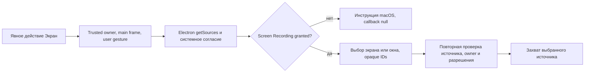

# Этап 04 — Демонстрация экрана и разрешения macOS

Дата: **28 октября 2026 года**. Версия проекта: **0.2.1-beta**. Продолжение [этапа 03](03_WEBRTC_MEDIA.md) в существующем Electron/React-приложении. Добавлены обработка Screen Recording и смена источника; настоящий захват тестового окна проверен на доступном Mac. Матрица приёмки и ограничения приведены ниже. Backend не менялся.

План перед изменениями: проверить закреплённые API, сохранить общий picker и проверки доверенного документа, добавить обработку системного отказа и безопасную смену источника, проверить доступные native-сценарии, регрессию и упаковку. Фактический `decs_maket` — HTML/CSS/JS-прототип с демонстрационными данными; его логика не является реализацией Electron capture. Отдельный frontend для Mac не создавался.

## API и границы разрешений

Проверены фактически установленные **Electron 44.9.3** и **electron-builder 26.17.0**, включая `electron/electron.d.ts`, `app-builder-lib/out/options/macOptions.d.ts` и реальную схему builder. Общий путь остаётся `getDisplayMedia` → main-process permission handler → `desktopCapturer` → WebRTC. Отдельная реализация frontend или backend для macOS не требуется.

`desktopCapturer.getSources` перечисляет экраны и окна. `display_id` может сопоставляться с `screen.getAllDisplays()`, но бывает пустым; номер в имени источника не является идентификатором монитора. Физический размер видеодорожки следует проверять отдельно от размеров интерфейса в DIP и `scaleFactor`. macOS требует согласие человека на захват экрана; наличие доступных API не означает полученного разрешения. [Electron desktopCapturer](https://www.electronjs.org/docs/latest/api/desktop-capturer), [DesktopCapturerSource](https://www.electronjs.org/docs/latest/api/structures/desktop-capturer-source).

`systemPreferences.getMediaAccessStatus('screen')` читает состояние доступа. `askForMediaAccess` принимает только `camera` и `microphone`: вызывать его с `screen` нельзя. Для отказа нужны понятные инструкции открытия системного раздела разрешений, а не подмена разрешения приложения. [Electron systemPreferences](https://www.electronjs.org/docs/latest/api/system-preferences), [настройки доступа к экрану и системному звуку Apple](https://support.apple.com/guide/mac-help/control-access-screen-system-audio-recording-mchld6aa7d23/mac).

Apple рекомендует системный `SCContentSharingPicker`. Однако в установленном Electron опция `useSystemPicker` экспериментальна, доступна на macOS 15+, и при использовании системного picker пользовательский `setDisplayMediaRequestHandler` **не вызывается**. Её нельзя просто включить в существующей архитектуре, рассчитывая сохранить проверки владельца, frame и отмены из этого handler. Переход требует отдельной проверки всей политики доступа. Передача `WebFrameMain` захватывает целый содержащий его WebContents; её нельзя использовать как неограниченный fallback для произвольного subframe. [Apple ScreenCaptureKit](https://developer.apple.com/documentation/screencapturekit), [Electron Session display handler](https://www.electronjs.org/docs/latest/api/session#sessetdisplaymediarequesthandlerhandler-opts).

## Info.plist, entitlements и Hardened Runtime

В `extendInfo` добавлена русская строка `NSScreenCaptureUsageDescription`: «MeetSpace использует запись экрана для демонстрации выбранного экрана или окна участникам встречи». Текущая официальная документация ScreenCaptureKit просит эту purpose string. Это пояснение назначения; оно не выдаёт TCC-разрешение и само по себе не подтверждает одинаковое поведение всех целевых версий macOS. Существующие `NSCameraUsageDescription` и `NSMicrophoneUsageDescription` сохранены. Проверка итогового `.app/Contents/Info.plist` требует все три значения. [Apple ScreenCaptureKit](https://developer.apple.com/documentation/screencapturekit).

Для обычной демонстрации экрана не добавляется отдельный entitlement Screen Recording: обычная модель — системное согласие пользователя. `com.apple.developer.persistent-content-capture` относится к VNC-приложениям и требует отдельного разрешения Apple; он не нужен для видеоконференций MeetSpace. В конфигурацию не добавлены persistent capture, Apple Events, accessibility, отключение library validation или другие обходы. [Apple Persistent Content Capture](https://developer.apple.com/documentation/bundleresources/entitlements/com.apple.developer.persistent-content-capture), [Apple Hardened Runtime](https://developer.apple.com/documentation/xcode/configuring-the-hardened-runtime).

Исходный `node_modules/electron/dist/Electron.app/Contents/Info.plist` уже содержит `NSAudioCaptureUsageDescription` со стандартным английским пояснением Electron. Эта метаинформация наследуется упаковкой. Она не означает, что MeetSpace включает захват системного звука. Ключ не добавлялся и не переопределялся для данного этапа; `NSSystemAudioCaptureUsageDescription` — другое имя, его отсутствие не является проверкой правильного ключа. Тесты проверяют оба имени. Системный звук нельзя считать поддержанным только по наличию purpose string: это отдельный путь capture и отдельная приёмка. [Electron macOS audio capture](https://www.electronjs.org/docs/latest/api/desktop-capturer#caveats).

Текущая сборка — локальная unsigned `.app`: `identity: null`, `notarize: false`, `publish: null`. В установленном builder `identity: null` пропускает подпись. Значение Hardened Runtime по умолчанию относится к подписи и **не доказывает**, что unsigned-приложение прошло проверку Hardened Runtime. Эта сборка не является notarized-релизом.

Для будущего этапа 06 необходимы Developer ID, Hardened Runtime, отдельная проверка entitlements основного процесса и helpers, нотариализация и тесты обеих архитектур. Apple требует Hardened Runtime для нотариализации и рекомендует минимальные исключения. Локальный шаблон builder включает `allow-jit`, `allow-unsigned-executable-memory` и `disable-library-validation`; его нельзя автоматически принять как минимальную политику MeetSpace. В этом этапе шаблон не подключался, подпись и системные настройки не менялись. Chromium renderer sandbox и macOS App Sandbox — разные механизмы; отсутствие MAS/App Sandbox в текущей `.app` не является основанием отключать renderer sandbox. [Apple Hardened Runtime](https://developer.apple.com/documentation/xcode/configuring-the-hardened-runtime), [Electron signing and notarization](https://www.electronjs.org/docs/latest/tutorial/code-signing#signing--notarizing-macos-builds).

## Существующие проверки и пригодность для macOS

| Проверка | Что можно использовать | Ограничение |
| --- | --- | --- |
| `desktop/tests/linux-screen-runner.cjs` и `linux-screen-electron.cjs` | Безопасное окно с меняющимся цветным рисунком; production permission path; реальные локальные и декодированные WebRTC кадры; остановка и очистка tracks/PeerConnections | Оба файла явно требуют Linux. Нельзя запускать неизменёнными на macOS и считать PASS |
| Сценарии Linux screen harness | `window-app-stop`, `monitor-app-stop`, `window-external-stop`, `window-source-gone`, `cancel`, `late-choice` | Portal/X11 automation не проверяет TCC/ScreenCaptureKit; автоматический выбор всего экрана нельзя переносить без ограничения тестового содержимого |
| `desktop/tests/media-electron.cjs` | Trusted-window/frame checks, picker IPC, отмена и lifecycle | Подменённая выдача display sources и synthetic own-tab capture — не настоящий захват экрана macOS |
| SFU/media lifecycle harnesses | Кодирование, доставка, замена и очистка медиадорожек | Синтетические источники не подтверждают системное согласие, Retina, несколько мониторов или закрытие настоящего окна |

Для настоящего macOS screen harness рекомендуется переиспользовать безопасный рисунок и проверки декодирования, но создать отдельную Darwin-обёртку с настоящими `desktopCapturer`/`getDisplayMedia`. Записывать версии, source provenance, TCC-состояние, выбранный вид источника, список экранов без названий пользовательских окон, `scaleFactor`, track settings, изменение кадров и завершение tracks. Не сохранять скринкаст. Отдельно проверять отмену, смену источника, закрытие исходного окна, остановку из приложения/системы и отсутствие запоздалой выдачи после закрытия владельца. Несколько мониторов, первый Allow/Deny и отзыв разрешения требуют соответствующего реального стенда/действия пользователя.

## Выполненные проверки упаковочной политики

Scoped unit run на Node 24: **28 PASS, 0 FAIL, 0 SKIP** — `macos-package-policy.test.cjs`, `prepare-builder.test.cjs`, `linux-package-policy.test.cjs`. Проверена настоящая schema builder для x64 и ARM64, exact purpose strings и отклонение отсутствующих/пустых/нестроковых значений, отсутствие новых entitlements/подписи, а также существующие Linux packaging и NSIS preparation проверки. Результат этого прогона относится к упаковочной политике, а не к GUI или физическому захвату.

Этот scoped-прогон входит в общую проверку ниже и не суммируется с ней как отдельные уникальные тесты.

## Реализованное поведение

`MacOSScreenAccess` читает состояние разрешения без кэширования, запросов доступа и изменения системных настроек. В закреплённом Chromium screen preflight фактически возвращает `allowed/denied`: начальный `denied` возможен ещё до первого вопроса пользователю. Поэтому он **не блокирует первый явный `getSources`**. Electron сам вызывает `CGRequestScreenCaptureAccess` при перечислении. После перечисления, перед повторным перечислением выбранного источника и сразу после него требуется `granted`. Между последней проверкой владельца/разрешения и выдачей source нет `await`. [Electron 44.9.3 implementation](https://raw.githubusercontent.com/electron/electron/v44.9.3/shell/browser/api/electron_api_desktop_capturer.cc), [Chromium 152 permission mapping](https://raw.githubusercontent.com/chromium/chromium/152.0.7977.167/chrome/browser/permissions/system/system_media_capture_permissions_mac.mm).

- Отказ и недоступность native permission завершают запрос без источников/превью в renderer. Фиксированный `denied` event показывает путь в системные настройки и необходимость ⌘Q при смене разрешения; native exception/названия окон в ошибку не передаются.
- Пустой список и сбой перечисления получают ограниченный `error` event. Исчезнувшее окно не заменяется первым доступным источником.
- ID экранов/окон остаются в main. В renderer уходят одноразовые opaque ID, ограниченные имена и PNG-превью; после выбора native ID сверяется с новым списком, независимо от порядка дисплеев. Превью не используются для расчёта разрешения захватываемого видео.
- Навигация, закрытие/скрытие владельца, suspend, смена профиля и timeout завершают pending-запрос один раз. Mutex перечисления сохраняется до завершения старого native promise: новый документ не наследует результат объединённого `getSources`.
- Общий React picker сохраняет инструкцию при terminal event и позднем завершении selection promise. Закрытые/заменённые ID хранятся в ограниченном наборе из 64 элементов; запоздавшие `request/denied/error` не открывают закрытый диалог снова. Новый отказ, пришедший до списка источников, по-прежнему показывается.
- Кнопка **«Сменить источник»** добавлена в конференцию и личный звонок. Новое `getDisplayMedia` вызывается непосредственно из явного действия. Старые tracks живут до успешной замены обоих sender; отмена сохраняет текущий показ, сбой откатывает sender на прежние живые tracks. Если откат невозможен, capture освобождается.
- Остановка, закрытие клиента и запреты модератора имеют приоритет над незавершённой заменой/откатом; late capture завершается без повторной публикации. `ended` видеоисточника прекращает весь показ, включая связанный screen audio. Тесты закрытия настоящего окна подтвердили этот native event.
- Системный звук macOS не запрашивается и не передаётся: разрешён только выбранный video source. Опция loopback остаётся доступна только в существующем Windows-пути. Поддержка Linux portal не менялась.

Новых общих IPC-команд, прав доступа или backend-контрактов нет. Добавлены два фиксированных варианта существующего события picker. In-process `screenAccess` test seam работает только в непакетированном trusted test entry; из CLI/env/renderer его выбрать нельзя, packaged `.app` его игнорирует.

## Матрица фактических проверок

| Среда | Результат |
| --- | --- |
| macOS 27.2.0 Golden Gate ARM64, Electron 44.9.3 / Chromium 152.0.7977.167 | Реальный захват окна на Retina, перенос на внешний дисплей с изменением масштаба, локальное WebRTC-декодирование, отмена и закрытие источника проверены |
| macOS 15 Sequoia Intel x64 | Нет нативного стенда: runtime/capture блокированы отсутствием среды; cross-build не считается приёмкой Intel |
| macOS 15 Sequoia ARM64 | Нет стенда: не проверено |
| macOS 26 Tahoe ARM64 | Нет стенда: не проверено |
| Windows 10/11 и Linux | Общие unit/renderer-проверки выполнены; нативная GUI-приёмка на этих ОС в этом этапе не запускалась |

Официальное имя macOS 27 и источники зафиксированы в [аудите этапа 01](01_ARCHITECTURE_AUDIT.md). Совместимость остальных строк из результата текущего Mac не выводится.

## Настоящий захват окна

Опт-ин harness использует production `startApp`, sandboxed renderer, неизменённые `desktopCapturer`/`getDisplayMedia` и обычное системное разрешение. Выбор выполнен через видимую UI-кнопку; тестовый renderer предлагает **только собственное окно с безопасным цветным рисунком**. Другие окна и весь рабочий стол не захватывались. Реальный локальный RTCPeerConnection кодирует и декодирует VP8; SFU и внешняя сеть в этом harness не используются. Записи/изображения/полный inventory окон не сохраняются.

Результаты отмены и закрытия источника: [native-final](../../desktop/artifacts/macos-stage04/native-final/). Финальный повтор захвата и полной очистки на текущем наборе исходников: [native-current/window-app-stop.json](../../desktop/artifacts/macos-stage04/native-current/window-app-stop.json), **PASS**, 18/8 кадров и все четыре cleanup-проверки true. Его source hash совпадает со сборками и финальным SFU-прогоном ниже.

| Сценарий | Наблюдение |
| --- | --- |
| `window-app-stop` | PASS: 18 локальных и 8 декодированных кадров, меняющийся небелый цветной рисунок, фактический размер видео **2000×1360**, остановка приложения, все tracks/peers/video elements освобождены |
| `cancel` | PASS: после открытия списка нажата отмена; browser `AbortError`, capture не выдан, кадров нет, cleanup пройден |
| `window-source-gone` | PASS: 19 локальных / 10 декодированных кадров; тестовое окно реально закрыто, пришёл `ended`, все tracks/peers/video elements освобождены |
| `window-multi-display` | PASS после повторного подключения внешнего дисплея: окно 1000×680 DIP перенесено с Retina (scaleFactor=2) на внешний экран (scaleFactor=1); локальные и декодированные кадры изменились с 2000×1360 на 1000×680; после появления нового размера получено ещё 13 декодированных кадров, cleanup пройден |

В первых трёх прогонах inventory показывал встроенный дисплей **1728×1117 DIP, scaleFactor=2** и внешний **1920×1080 DIP, scaleFactor=1**. В первоначальном multi-display-прогоне оставался только первый, поэтому его исторический NOT_RUN сохранён в `native-final`. После подключения внешнего Philips выполнен [повторный multi-display-прогон](../../desktop/artifacts/macos-stage04/native-two-displays-verified/window-multi-display.json), [лог](../../desktop/artifacts/macos-stage04/native-two-displays-verified.log): **PASS**, 50 локальных / 33 декодированных callback кадров. Проверены фактические границы окна и соответствующий дисплей до и после переноса. Размер окна **1000×680 DIP** сохранён: изменение видео **2000×1360 → 1000×680** связано со сменой масштаба, а не с изменением размеров окна. После переноса пришло ещё 25 декодированных кадров, включая 13 после подтверждения нового размера. Все четыре финальные cleanup-проверки — true. Первоначальные `getSettings` до первых кадров могли ещё содержать размер монитора; в отчёте используются фактические video frame dimensions.

Первая попытка после подключения второго монитора [native-two-displays](../../desktop/artifacts/macos-stage04/native-two-displays/window-multi-display.json) не дала выбрать безопасное окно: оно отсутствовало среди предложенных источников; выбор отменён, захвата не было. Этот FAIL сохранён. В тестовой обёртке окна расположены раздельно, имя безопасного окна задано явно; также исключён ложный PASS при остановке до завершения переноса. Основной код приложения не менялся.

Во всех этих прогонах TCC уже имел `granted` до и после теста под **development identity Electron**. Первый Allow/Deny и ручной отзыв разрешения не воспроизводились, TCC не сбрасывался. Захват подписанной установленной identity, остановка через системный индикатор и полноэкранный захват каждого монитора остаются отдельной приёмкой.

Первый эксперимент [native/window-app-stop.json](../../desktop/artifacts/macos-stage04/native/window-app-stop.json) завершился FAIL: выбор в UI не был сделан до timeout, выдачи capture не было. Лог и состояние сохранены; последующий явный выбор прошёл. Этот первый timeout не выдаётся за успешный аппаратный тест.

## Проверки логики и интерфейса

| Проверка | Фактический результат |
| --- | --- |
| Полная Desktop suite | **376 PASS, 0 FAIL, 1 SKIP** из 377; skip — Linux GIO на Mac; [лог](../../desktop/artifacts/macos-stage04/desktop-tests.log) |
| Общий media lifecycle frontend | **55/55 PASS**; новые случаи смены source, обоих sender, rollback, stop/moderation, late picker и Mac guidance; [лог](../../desktop/artifacts/macos-stage04-media-check.log) |
| Настоящий React picker в Chromium | **14 сценариев PASS**: выбор, terminal events + resolve/reject, отмена/Escape/backdrop, устаревшие запросы, cleanup, Windows audio opt-in и Linux portal; [JSON](../../desktop/artifacts/macos-stage04/picker-ui.json), [лог](../../desktop/artifacts/macos-stage04/picker-ui.log) |
| Frontend foundation | **30/30 PASS**; [лог](../../desktop/artifacts/macos-stage04/foundation.log) |
| Frontend assets | **9/9 PASS**; [лог](../../desktop/artifacts/macos-stage04/assets.log) |
| Chromium permission/lifecycle harness | **PASS**, trusted handlers, subframe/foreign window, opaque picker и simulated suspend; [лог](../../desktop/artifacts/macos-stage04/chromium-media.log) |
| Pion SFU + смена source | **4/4 PASS**, 2/3 участника direct/relay; [результат](../../desktop/artifacts/macos-stage04/sfu/result.json), [лог](../../desktop/artifacts/macos-stage04/sfu.log) |
| Повторный lifecycle | **100 циклов**, по 100 замен камеры/микрофона и synthetic screen start/stop; [результат](../../desktop/artifacts/macos-stage04/lifecycle/result.json), [лог](../../desktop/artifacts/macos-stage04/lifecycle.log) |
| TypeScript / web / desktop build | **PASS**; [frontend typecheck](../../desktop/artifacts/macos-stage04-frontend-typecheck.log), [web](../../desktop/artifacts/macos-stage04/web-build.log), [desktop](../../desktop/artifacts/macos-stage04/final-build.log) |

В picker UI harness native capture, системные permissions, auth и сеть запрещены. Он проверяет production React DOM с mock bridge, не TCC. Первый прогон воспроизвёл повторное открытие закрытого диалога; [исходный FAIL](../../desktop/artifacts/macos-stage04/picker-ui-initial.json) сохранён. После исправления bounded retired IDs сценарий включён в итоговые 14 PASS.

SFU fixture импортирует неизменённый Pion из закреплённого backend commit `66e482c9701b6c13f58bc93aee8d9f5cf932dd34`. Общий `ConferenceMediaClient` работает в настоящем Chromium. После late join/leave/rejoin один участник включает красный canvas **640×360**, затем меняет его на зелёный. В каждом из четырёх случаев остальные участники декодируют новый VP8-кадр с изменившимся цветом; это проверка фактического изображения, не только `screenSharing=true`. Старые tracks переходят в `ended`, новые sender/track IDs сверяются, дубли SFU-публикаций не появляются. Камера и микрофон остаются живыми; после stopScreen SFU возвращается к baseline. Подробности — `screenSwitchChecks` в файлах `2-direct.json`, `2-relay.json`, `3-direct.json`, `3-relay.json` внутри [sfu](../../desktop/artifacts/macos-stage04/sfu/).

TURN локальный и временный. Relay подтверждён выбранными relay-кандидатами Chromium и allocations, а не только флагом. После окончательной остановки peers/rooms/tracks/subscriptions/TURN allocations — **0**, все захваченные tracks и PeerConnection закрыты. В логах есть TURN CreatePermission `600` для отброшенных ICE-кандидатов; выбранные relay-пары передают проверенное изображение. Это не приёмка внешнего NAT, production auth или настоящей смены native окна: screen streams в SFU-тесте созданы синтетическим `canvas.captureStream`.

100-цикловый harness с историческим именем `linux-media-lifecycle-runner.cjs` выполнен именно на Darwin/ARM64, с настоящими Chromium/Pion и синтетическим capture. Всего 301 capture; финальные live tracks/peers/retained clients — **0**, созданный PeerConnection закрыт. Два исходных таймера приложения остались на baseline; нулевое число всех таймеров и полное отсутствие всех утечек не утверждаются.

## Проверка `.app`

Собраны локальные тестовые приложения **0.2.1-beta**:

| Цель | Артефакт и проверка |
| --- | --- |
| ARM64 | [MeetSpace.app](../../desktop/artifacts/macos-stage02-arm64-vRvJfk/mac-arm64/MeetSpace.app), [receipt](../../desktop/artifacts/macos-stage02-arm64-vRvJfk/macos-unpacked-verification.json); упаковка PASS, настоящий запуск `app://meetspace/` и завершение через ⌘Q подтверждены |
| Intel x64 | [MeetSpace.app](../../desktop/artifacts/macos-stage02-x64-pQ4ORP/mac/MeetSpace.app), [receipt](../../desktop/artifacts/macos-stage02-x64-pQ4ORP/macos-unpacked-verification.json); cross-build PASS, запуск на Intel не проверен |

Логи: [ARM64](../../desktop/artifacts/macos-stage04/package-arm64.log), [x64](../../desktop/artifacts/macos-stage04/package-x64.log). Проверены фактические Mach-O всех helpers/framework/executable, ASAR и privacy strings итогового plist. Обе `.app`, финальный native window capture и SFU используют `sourceTreeSha256` **`e293413c3c7b679178d0584dec936c6213fb37731e8e0a6527fde6a4ca96be9a`**. Номер `stage: "02"` и названия `macos-stage02-*` остались от упаковщика этапа 02; приложения собраны заново.

Повторная проверка двух мониторов использует ту же сборку приложения `e293…`, но уточнённую тестовую обёртку. [Сверка исходников](../../desktop/artifacts/macos-stage04/two-displays-source-comparison.json) подтверждает единственное отличие — `desktop/tests/macos-screen-electron.cjs`; исходники продукта и зависимости не изменились. Текущий fingerprint тестового checkout — `7a1593f47b9b54d9659d6745e42d3670e5496441582356bf89b52a7b90e9c93c`; отдельные SHA-256 обеих частей harness сохранены в результате прогона. Пересборка `.app` для изменения только проверки не выполнялась.

Обе `.app` unsigned, без нотариализации и без включённых автообновлений. Проверка запуска ARM64 не считается тестом Screen Recording подписанной installed identity. DMG/ZIP, публикация и установка в UTM в задачу этапа 04 не входили.

## Ограничения и регрессия

Отсутствие стендов macOS 15/26/Intel — блокер проверки этих конфигураций. Для first-use/denied/revoked unit-тесты подставляют статусы, а реальное разрешение macOS в этом этапе не изменялось. Настоящая смена native источника в многопользовательском звонке, системная кнопка Stop Sharing, сон/смена сети, отключение монитора во время захвата, полноэкранный захват каждого дисплея и подписанный Hardened Runtime требуют дополнительной аппаратной приёмки. Проверенный перенос одного окна между Retina и внешним дисплеем не подтверждает эти отдельные сценарии.

Windows/Linux продолжают использовать общие React/WebRTC-модули. Проверки macOS применяются только на Darwin; Windows loopback и Linux portal остались отдельными ветками. Общие tests покрывают opaque picker, владельца/frame, late cancellation, ошибки и освобождение ресурсов. Runtime Windows/Linux в этом этапе не запускался; claims об их нативной приёмке не делаются.

## Файлы этапа

- `desktop/src/platform/macos-screen-access.ts`, `desktop/src/media-permissions.ts`, `desktop/src/main.ts` — read-only screen status, границы выдачи и terminal events.
- `frontend/src/platform/desktop-contracts.d.ts`, `frontend/src/components/desktop/DesktopScreenPicker.tsx` — ограниченные события и устойчивый диалог выбора.
- `frontend/src/media.ts`, `frontend/src/prejoinDevices.ts`, `frontend/src/components/RealtimePanel.tsx`, `frontend/src/components/DirectCallMedia.tsx` — безопасная замена источника, кнопка и macOS instructions.
- `desktop/electron-builder.macos.config.cjs`, `desktop/scripts/macos-package-policy.mjs`, `desktop/tests/macos-package-policy.test.cjs` — ScreenCapture usage description и проверка plist.
- `desktop/tests/macos-screen-access.test.cjs`, `macos-screen-policy-review.test.cjs`, `media-permissions.test.cjs`, `frontend/scripts/check-media-lifecycle.mjs` — проверки статусов, ownership, cancellation, смены и rollback.
- `desktop/tests/macos-screen-runner.cjs`, `macos-screen-electron.cjs`, `screen-picker-ui-runner.cjs`, `screen-picker-ui.cjs`, `sfu-electron.cjs` — native/React/SFU acceptance fixtures.
- `desktop/tests/fixtures/synthetic-media-access.cjs`, `desktop/tests/media-electron.cjs` — явный fake-screen seam для synthetic permission tests.
- `desktop/package.json`, `desktop/README.md`, `docs/README.md`, этот отчёт — команда проверки и документация.

Оба lockfile, зависимости и backend не изменены. Все 6 файлов предыдущей поддержки вложений сверены по SHA-256 с baseline этапа 03 и сохранены. Исходники предыдущих этапов остаются в рабочем дереве; коммит и публикация не выполнялись.

Этап 04 реализован и проверен в пределах доступного стенда. Перечисленные аппаратные конфигурации остаются непроверенными. Работа остановлена перед этапом 05.
